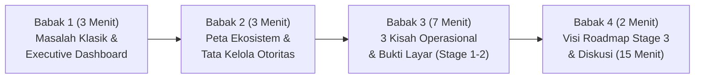
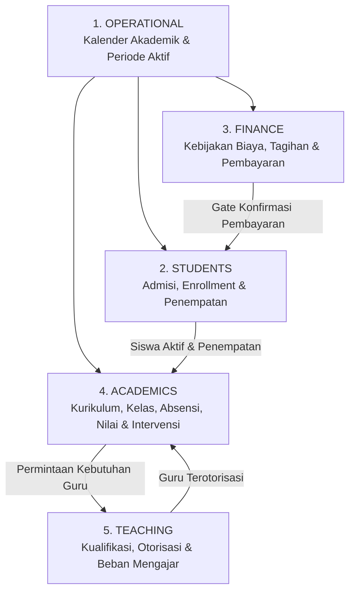

# Skenario Presentasi Eksekutif: Elsasa SIS V3 (15 Menit + 15 Menit Q&A)

**Target Audience:** Principal (Kepala Sekolah), Yayasan / Direksi, & Management Sekolah  
**Durasi Total:** 30 Menit (15 Menit Presentasi & Live/Screen Demo + 15 Menit Diskusi/Tanya Jawab)  
**Batas Cakupan Live System Saat Ini:** Stage 1 penuh + Stage 2 hingga **Teaching — Assignment & Workload** (sesuai [sub-modul-and-development-phases.md](file:///d:/Project.Private/elsasa-sis-v3/docs/sub-modul-and-development-phases.md#L53-L80)).

---

## Evaluasi Alur Awal vs. Penyempurnaan Strategis

Alur yang Anda rancang (**Masalah Klasik $\rightarrow$ Dashboard Keputusan $\rightarrow$ Modul & Role $\rightarrow$ Alur Operasional & Screen**) sudah memiliki fondasi *storytelling* yang sangat kuat karena dimulai dari *hook* eksekutif (Dashboard). 

Namun, karena waktu presentasi hanya **15 menit** dan audiensnya adalah **Principal & Management**, ada **3 jebakan** yang harus dihindari agar mereka tidak bosan atau kehilangan fokus:

> [!WARNING]
> **Jebakan Presentasi Sistem di Hadapan Manajemen (15 Menit):**
> 1. **Terlalu lama menjelaskan daftar 20 modul & 20 role secara teoritis:** Manajemen tidak ingin menghafal struktur database atau daftar menu. Jika Anda menghabiskan 5 menit di slide arsitektur modul dan role, energi ruangan akan turun.
> 2. **Alur operasional terasa seperti "pelatihan admin":** Principal tidak peduli tombol mana yang diklik staf admin untuk menginput data, **kecuali** Anda menunjukkan bagaimana layar tersebut *mencegah kebocoran uang, mencegah nilai palsu, atau menghentikan siswa berisiko jatuh terlalu jauh*.
> 3. **Memisahkan Dashboard di awal dan Operasional di akhir tanpa benang merah:** Akan jauh lebih memukau jika layar operasional yang Anda tunjukkan adalah **tindak lanjut langsung (drill-down)** dari masalah yang muncul di Dashboard pada menit pertama!

### Solusi Alur Baru: *"The Closed-Loop Executive Story"*
Kita tetap menggunakan kerangka Anda, tetapi merombak cara penyampaiannya menjadi **4 Babak Terkait** yang sangat padat:

---

## Rincian Skenario & Naskah Presentasi (Menit demi Menit)

### Babak 1: Masalah Klasik & Jawaban "Satu Layar" (Menit 00:00 – 03:00)

**Tujuan:** Membuat Principal merasa *"Ini persis masalah saya setiap minggu"* dalam 60 detik pertama, lalu langsung menyajikan **Management Attention Center** sebagai obatnya.

* **Menit 00:00 – 01:00 | Hook: 3 "Kebutaan" Klasik Manajemen Sekolah**
  * *Narasi Utama:*
    > "Bapak/Ibu Kepala Sekolah dan Manajemen, dalam mengelola sekolah, masalah terbesar kita biasanya bukan kurangnya data, melainkan **data yang terpisah-pisah (silo) dan terlambat**.  
    > 1. Saat ditanya *'Berapa siswa baru yang sudah resmi aktif dan lunas uang pangkal hari ini?'* — Admisi dan Keuangan sering punya angka berbeda.  
    > 2. Saat nilai rapor akhir semester keluar, kita baru sadar ada siswa yang nilainya anjlok dan tidak naik kelas — **terlambat untuk diintervensi**.  
    > 3. Saat menyusun jadwal dan beban mengajar, kita kesulitan memastikan guru yang mengajar benar-benar tersertifikasi dan tidak kelebihan jam (*overload*)."
* **Menit 01:00 – 03:00 | Solusi: Executive Overview & 5-Step Decision Journey**
  * **Tampilkan:** Konsep/Layar **Executive Overview (`/dashboard` — Management Attention Center)** ([KPI-DASHBOARD-IA.md](file:///d:/Project.Private/elsasa-sis-v3/docs/kpi/KPI-DASHBOARD-IA.md#L52-L114)).
  * *Poin Kunci yang Ditekankan:*
    * Elsasa SIS tidak sekadar mencatat administrasi, tetapi dirancang dengan **5-Step Management Decision Journey**:
      1. *Apa kondisi sekolah hari ini?* (6 Kartu Kesehatan Domain).
      2. *Apa yang butuh perhatian pimpinan sekarang?* (**Critical Management Attention Strip** — misal: `14 Siswa At-Risk belum punya rencana intervensi`, `4 Kebutuhan Guru belum terisi`, `9 Pembayaran menunggu verifikasi`).
      3. *Kenapa ini terjadi?* $\rightarrow$ Klik ke Dashboard Domain.
      4. *Di kelas/jenjang mana masalahnya?* $\rightarrow$ Breakdown KPI.
      5. *Tindak lanjuti sekarang!* $\rightarrow$ 1 klik langsung membuka layar kerja operasional (*Workbench*) yang terkait.

---

### Babak 2: Peta Ekosistem 6 Domain & Pemisahan Wewenang (Menit 03:00 – 06:00)

**Tujuan:** Menunjukkan kematangan arsitektur Elsasa SIS (modul & role) **tanpa** membacakan tabel satu per satu. Gunakan sudut pandang **Governance (Tata Kelola & Kontrol Internal)**.

* **Menit 03:00 – 04:30 | 6 Domain yang Saling Mengunci (Bukan Berdiri Sendiri)**
  * **Tampilkan:** Diagram hubungan 6 Domain & 20 Modul ([sub-modul-and-development-phases.md](file:///d:/Project.Private/elsasa-sis-v3/docs/sub-modul-and-development-phases.md#L23-L48)).
  * *Narasi Utama:*
    > "Mengapa Dashboard tadi bisa sangat akurat? Karena di belakangnya, Elsasa SIS dibangun di atas **6 Domain Terintegrasi**: **Operational** (Kalender & Periode), **Students** (Admisi & Siklus Hidup Siswa), **Finance** (Kewajiban & Pembayaran), **Academics** (Kurikulum, KBM, Penilaian), **Teaching** (Profil, Otorisasi & Beban Guru), serta **Development** (Karakter & Konseling)."
  * **Tunjukkan Status Implementasi Secara Transparan & Positif:**
    * Sampaikan bahwa fondasi hingga inti akademik dan penugasan guru (**Stage 1 penuh** hingga **Stage 2: Teaching Assignment & Workload**) sudah terbangun di dalam sistem.

* **Menit 04:30 – 06:00 | Role & Tanggung Jawab: "Maker – Checker – Approver"**
  * **Tampilkan:** Konsep Pemisahan Peran dari [actors.md](file:///d:/Project.Private/elsasa-sis-v3/docs/actors.md#L5-L27).
  * *Tips Presentasi:* **Jangan** bahas semua 20 aktor satu per satu. Kelompokkan menjadi **3 Lapis Pertahanan Sekolah** yang sangat disukai Principal:
    1. **Lapis Eksekutor Harian (*Officers & Teachers*):** *Admission Officer, Student Admin Officer, Finance Officer, Teacher* — menginput dan memproses antrean kerja harian.
    2. **Lapis Perencana & Pengatur (*Coordinators*):** *Academic Coordinator, Teaching Coordinator, Operations Coordinator* — menyusun struktur kurikulum, merancang *Student Learning Plan (SLP)*, dan memetakan jadwal/alokasi guru.
    3. **Lapis Pemegang Otoritas (*Authorities & School Leadership*):** *Principal, Academic Authority, Finance Authority, Teaching Authority* — hanya peran ini yang berhak mengesahkan kebijakan biaya, mengunci/mempublikasikan nilai rapor, menyetujui *override* pembayaran pendaftaran, dan mengesahkan surat tugas mengajar. **Tidak ada staf yang bisa mengubah nilai yang sudah terbit atau meloloskan siswa tanpa izin pimpinan.**

---

### Babak 3: Alur Operasional Sekolah & Bukti Layar (Menit 06:00 – 13:00)

**Tujuan:** Membawa audiens menyelami alur operasional nyata dari hulu ke hilir yang sudah diimplementasikan (Stage 1 sampai Stage 2 *Teaching Assignment & Workload*), sambil mencocokkannya dengan layar (*Screen*) berpola **Work Queue (Worklist + Workbench)** ([screen-inventory.md](file:///d:/Project.Private/elsasa-sis-v3/docs/screen-inventory.md#L67-L87)).

Bagi menjadi **3 Alur Cerita Eksekutif** (masing-masing ~2 menit):

#### Alur 1: "Zero-Leakage Intake" — Dari Kalender, Pendaftaran, hingga Gerbang Keuangan (Stage 1)
* **Garis Besar Alur:**
  1. Sekolah menetapkan Tahun Ajaran, Semester, dan Kalender Akademik sebagai acuan tanggal seluruh divisi.
  2. Calon siswa mendaftar & dievaluasi oleh Admisi.
  3. Saat dinyatakan **Diterima (Accepted)**, sistem otomatis menerbitkan tagihan biaya masuk sesuai kebijakan keuangan.
  4. Staf Administrasi Siswa **tidak bisa** mengaktifkan Nomor Induk Siswa (*Enroll*) sebelum ada konfirmasi pelunasan dari Keuangan — **kecuali** ada *Executive Override* resmi dari Principal yang tercatat di audit log!
* **Pencocokan Layar (Screens):**
  * [`SCR-OPS-01` Calendar & Periods Workspace](file:///d:/Project.Private/elsasa-sis-v3/docs/screen-inventory.md#L150): Menetapkan tahun ajaran & periode operasional.
  * [`SCR-FIN-04` Financial Policy Workspace](file:///d:/Project.Private/elsasa-sis-v3/docs/screen-inventory.md#L148) & [`SCR-FIN-01` Billing Cycle Workspace](file:///d:/Project.Private/elsasa-sis-v3/docs/screen-inventory.md#L145): Mengatur tarif dan menerbitkan tagihan.
  * [`SCR-FIN-02` Payment Verification Queue](file:///d:/Project.Private/elsasa-sis-v3/docs/screen-inventory.md#L146): Kasir memverifikasi bukti bayar dan mengalokasikan dana.
  * [`SCR-STU-01` Student Intake Workbench](file:///d:/Project.Private/elsasa-sis-v3/docs/screen-inventory.md#L132) & [`SCR-STU-02` Student Records Desk](file:///d:/Project.Private/elsasa-sis-v3/docs/screen-inventory.md#L133): Layar antrean pendaftaran dengan indikator *Payment Gate* langsung dari Finance, penetapan NIS, dan penempatan kelas/rombel.

#### Alur 2: "Right Teacher, Right Class" — Kualifikasi & Beban Mengajar Guru (Stage 2 — Teaching)
* **Garis Besar Alur:**
  1. Kurikulum dan mata pelajaran (*Learning Units*) yang disusun oleh Akademik menghasilkan **Kebutuhan Pengajar (Teaching Demand)**.
  2. Sebelum guru boleh ditugaskan ke kelas atau menjadi wali kelas (*homeroom*), kualifikasi dan lisensinya diverifikasi terlebih dahulu hingga terbit **Teaching Authorization**.
  3. Koordinator Pengajaran mencocokkan ketersediaan waktu guru, mengecek batas beban mengajar (*workload cap*), meminta persetujuan *Teaching Authority*, dan menangani guru pengganti (*substitution*) jika ada guru berhalangan.
* **Pencocokan Layar (Screens):**
  * [`SCR-TCH-01` Faculty Resource Workspace](file:///d:/Project.Private/elsasa-sis-v3/docs/screen-inventory.md#L154): Profil guru, verifikasi ijazah/sertifikasi, dan status otorisasi mengajar.
  * [`SCR-TCH-04` My Teaching Availability](file:///d:/Project.Private/elsasa-sis-v3/docs/screen-inventory.md#L157): Guru mendeklarasikan ketersediaan jam mengajar.
  * [`SCR-TCH-02` Teaching Assignment & Coverage Workbench](file:///d:/Project.Private/elsasa-sis-v3/docs/screen-inventory.md#L155): Menjawab kebutuhan guru dari Akademik, menugaskan guru/wali kelas, dan mengatur guru pengganti (*substitute*).
  * [`SCR-TCH-03` Faculty Workload Monitoring](file:///d:/Project.Private/elsasa-sis-v3/docs/screen-inventory.md#L156): Memantau beban mengajar seluruh guru agar tidak terjadi kelebihan beban tanpa izin pimpinan.

#### Alur 3: "No Student Left Behind" — Dari KBM, Penilaian, hingga Intervensi Dini (Stage 2 — Academics)
* **Garis Besar Alur:**
  1. Akademik menetapkan struktur kurikulum, atau membuat *Student Learning Plan (SLP)* khusus bagi siswa berkebutuhan khusus/akselerasi.
  2. Guru yang sudah ditugaskan melaksanakan sesi kelas, mencatat kehadiran (*attendance*), memberikan tugas, dan melakukan penilaian (*assessment*).
  3. Nilai yang diinput guru berstatus *provisional* dan harus disetujui *Academic Authority* sebelum terbit menjadi Rapor/Transkrip.
  4. **Poin Emas bagi Principal:** Jika siswa mengalami penurunan performa, guru/koordinator langsung membuka **Academic Intervention** dan memantau progresnya hingga tuntas, lalu menghasilkan rekomendasi kenaikan kelas (*Promotion/Retention*).
* **Pencocokan Layar (Screens):**
  * [`SCR-ACD-03` Curriculum & Learning Structure Workspace](file:///d:/Project.Private/elsasa-sis-v3/docs/screen-inventory.md#L138) & [`SCR-ACD-04` Learning Plan Workspace](file:///d:/Project.Private/elsasa-sis-v3/docs/screen-inventory.md#L139): Fondasi kurikulum dan rencana belajar individual (SLP).
  * [`SCR-ACD-05` Participation & Roster Workbench](file:///d:/Project.Private/elsasa-sis-v3/docs/screen-inventory.md#L140) & [`SCR-ACD-01` Class Session Workbench](file:///d:/Project.Private/elsasa-sis-v3/docs/screen-inventory.md#L136): Penempatan siswa ke mata pelajaran, pelaksanaan KBM, dan presensi.
  * [`SCR-ACD-02` Coursework & Assessment Workbench](file:///d:/Project.Private/elsasa-sis-v3/docs/screen-inventory.md#L137) & [`SCR-ACD-07` Academic Records Workbench](file:///d:/Project.Private/elsasa-sis-v3/docs/screen-inventory.md#L142): Tugas, penilaian, pengesahan nilai, rapor, dan *audit trail* koreksi nilai.
  * [`SCR-ACD-06` Academic Intervention Workbench](file:///d:/Project.Private/elsasa-sis-v3/docs/screen-inventory.md#L141) & [`SCR-ACD-09` Cohort Academic Review](file:///d:/Project.Private/elsasa-sis-v3/docs/screen-inventory.md#L144): Deteksi dini siswa berisiko, program intervensi akademik, dan penentuan status akademik (*Academic Standing* & rekomendasi naik/tinggal kelas).

---

### Babak 4: Roadmap Kedepan & Penutup ke Tanya Jawab (Menit 13:00 – 15:00)

**Tujuan:** Menjawab pertanyaan di benak manajemen sebelum mereka bertanya (*"Bagaimana dengan beasiswa, jadwal ruangan detail, konseling, atau kelulusan?"*) dengan memosisikannya sebagai **Roadmap Terencana**, bukan kekurangan sistem.

* **Menit 13:00 – 14:30 | Peta Jalan Pengembangan Berikutnya**
  * Tunjukkan bahwa karena fondasi Siswa, Kalender, Keuangan Dasar, Akademik, dan Penugasan Guru sudah berdiri kokoh, tahap berikutnya tinggal melengkapi:
    * **Lanjutan Stage 2:** Mutasi Cuti/Kenaikan Kelas & Daftar Ulang (*Student Lifecycle*), Manajemen Beasiswa/Piutang/Refund (*Expanded Finance*), dan Penjadwalan Ruangan (*Scheduling & Rooms*).
    * **Stage 3 (Maturity):** Pembinaan Karakter, Disiplin, Konseling Rahasia & Ekstrakurikuler (*Student Development*), serta Kelulusan, Alumni & *Dual Clearance* (Bebas Tanggungan Akademik & Keuangan).
* **Menit 14:30 – 15:00 | Call to Action & Pembuka Diskusi**
  * *Kalimat Penutup:*
    > "Dengan Elsasa SIS, Bapak/Ibu tidak lagi mengelola sekolah lewat tumpukan spreadsheet yang baru terkumpul di akhir bulan, melainkan melalui sistem yang menjaga aturan sekolah secara otomatis setiap hari. Mari kita gunakan 15 menit ke depan untuk berdiskusi—bagian mana dari alur tadi yang paling krusial bagi operasional sekolah Bapak/Ibu saat ini?"

---

## Strategi Menghadapi Sesi Tanya Jawab (15 Menit Terakhir)

Berikut adalah 4 pertanyaan yang hampir pasti ditanyakan oleh Principal/Manajemen beserta jawaban kuncinya di Elsasa SIS:

| Pertanyaan Klasik Principal / Manajemen | Jawaban Kunci Elsasa SIS V3 |
|---|---|
| **"Bagaimana kalau ada calon siswa VIP/anak guru yang harus masuk kelas dulu padahal uang pangkal belum lunas?"** | Sistem mengunci pendaftaran secara *default*, tetapi menyediakan fitur **Mandatory Administrative Payment Override** khusus untuk *School Leadership* (Principal) dengan alasan tertulis yang tercatat di log audit. |
| **"Apakah guru bisa mengubah nilai seenaknya setelah rapor dibagikan?"** | **Tidak bisa.** Nilai yang sudah disahkan oleh *Academic Authority* terkunci. Jika ada kesalahan input setelah publikasi, harus melalui alur **Correct Approved Academic Record** dengan otorisasi pimpinan dan jejak histori nilai lama vs nilai baru tetap tersimpan. |
| **"Apakah staf tata usaha tidak akan bingung karena fiturnya banyak?"** | Setiap layar di Elsasa SIS menggunakan pola seragam **Worklist + Workbench** (Satu Layar, Satu Konteks Kerja). Staf hanya melihat daftar antrean tugas yang menjadi wewenangnya hari itu, bukan puluhan menu tabel yang membingungkan. |
| **"Bagaimana sistem membantu kami menekan angka siswa tinggal kelas?"** | Lewat integrasi **Academic Standing & Intervention Workbench (`SCR-ACD-06`)**. Begitu nilai/kehadiran turun di tengah semester, siswa masuk radar *At-Risk* di Dashboard Principal, dan Koordinator Akademik wajib membuat serta memantau *Intervention Plan* sebelum ujian akhir tiba. |
