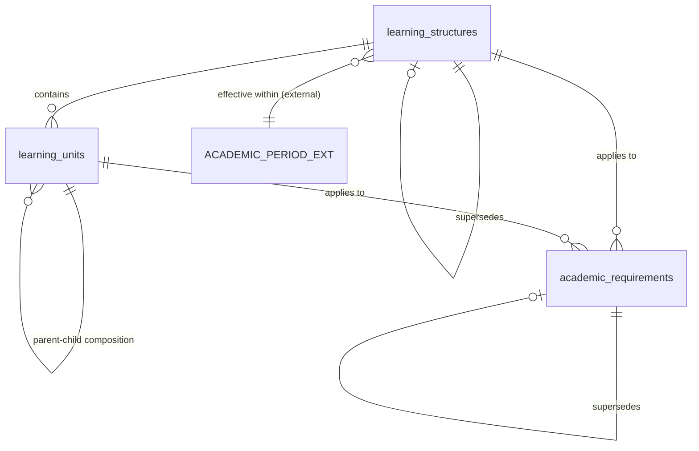
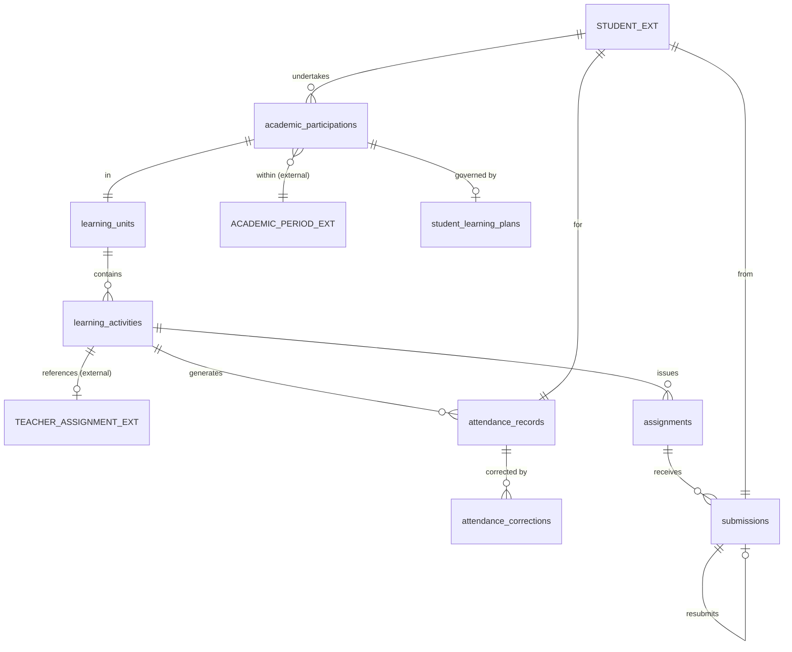
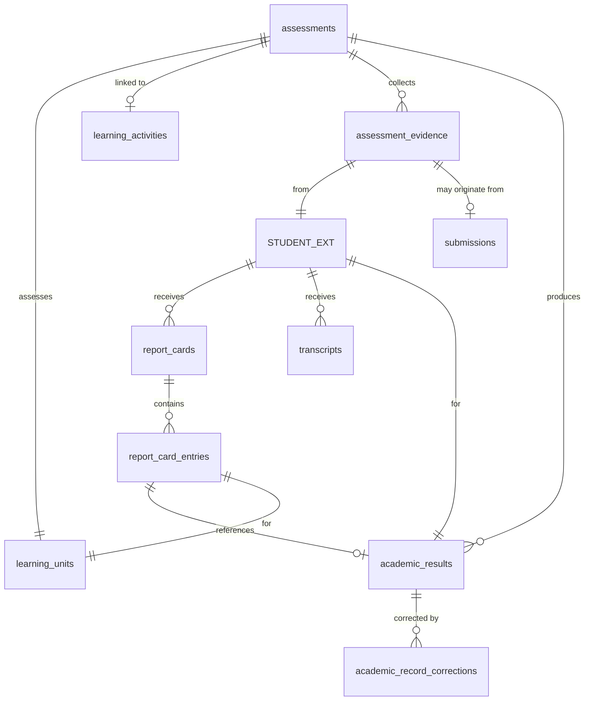
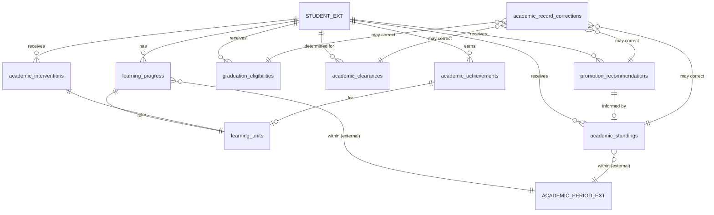
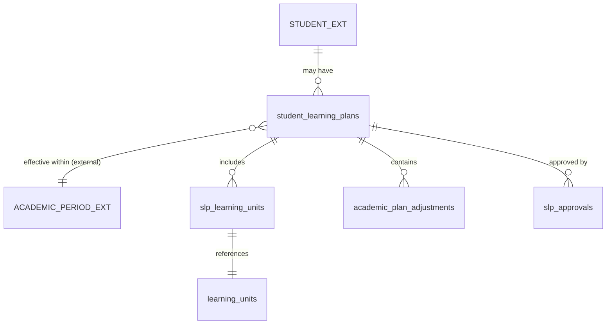
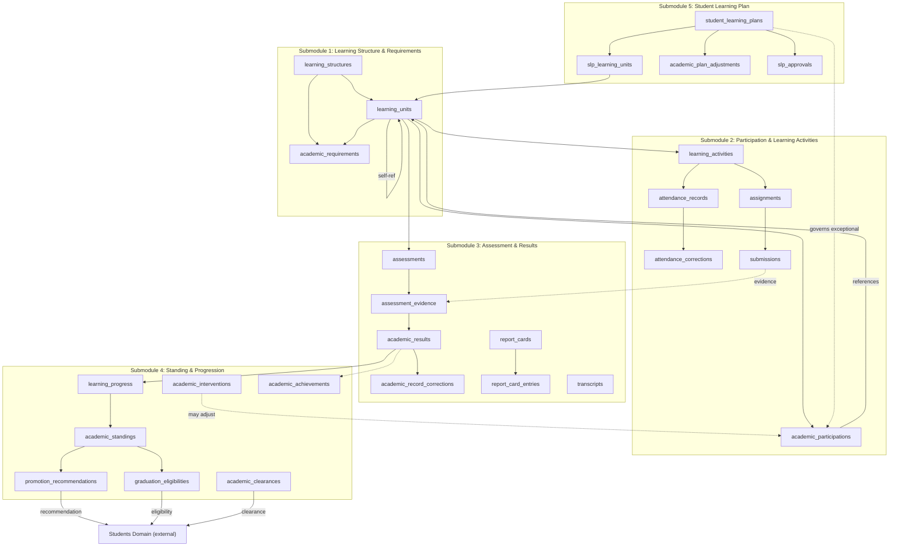

# Academic Domain — Database Tables by Submodule

## Source Documents

- [academic-domain.md](file:///d:/Project.Private/elsasa-sis-v3/domains/academic-domain.md) — Academic Domain definition
- [academic-entities.md](file:///d:/Project.Private/elsasa-sis-v3/entities/academic-entities.md) — Entity identification by submodule
- [sub-modul-and-development-phases.md](file:///d:/Project.Private/elsasa-sis-v3/sub-modul-and-development-phases.md) — Module decomposition and roadmap

## Conventions

- **PK** — Primary Key
- **FK** — Foreign Key (logical; referencing another table in this domain or an external domain)
- **UQ** — Unique constraint
- All tables include `created_at`, `updated_at`, and `created_by` audit columns (omitted from key-column listings for brevity)
- UUID is used as the primary key type throughout
- Columns marked *(nullable)* are not required at creation time, supporting progressive information collection
- External domain references (Students, Teaching, Operations) are stored as opaque identifiers; this domain does not own or define those tables
- Entity status values and type enumerations are stored as VARCHAR with application-level validation, consistent with the Student domain convention

---

## Submodule 1 — Learning Structure & Requirements

### 1.1 `learning_structures` — Main Table

| Aspect | Description |
|---|---|
| **Purpose** | The top-level organizational container describing the learning recognized by the school. Groups Learning Units into a coherent curriculum framework for a given academic context (program, level, or school-wide curriculum). |
| **Type** | Core |

**Key Columns:**

| Column | Type | Constraint | Description |
|---|---|---|---|
| `id` | UUID | PK | Unique identifier |
| `name` | VARCHAR | NOT NULL | Human-readable name (e.g., "Kurikulum Merdeka SD 2024") |
| `description` | TEXT | nullable | Description of the learning structure |
| `academic_period_id` | UUID | FK → external (Operations), NOT NULL | Academic period this structure is effective within |
| `academic_period_label` | VARCHAR | NOT NULL | Human-readable period label (e.g., "TP 2024/2025") |
| `version` | VARCHAR | NOT NULL | Version identifier (e.g., "2024.1") |
| `effective_date` | DATE | NOT NULL | Date this structure becomes effective |
| `end_date` | DATE | nullable | Date this structure ceases to be effective (null = current) |
| `status` | VARCHAR | NOT NULL | Status: `draft`, `active`, `superseded`, `archived` |
| `approved_by` | VARCHAR | nullable | Person who approved this structure |
| `approved_date` | DATE | nullable | Date approved |
| `supersedes_id` | UUID | FK → `learning_structures.id`, nullable | Previous version this supersedes |
| `notes` | TEXT | nullable | Internal notes |

**Example:**

| name | version | effective_date | status | approved_by |
|---|---|---|---|---|
| Kurikulum Merdeka SD 2024 | 2024.1 | 2024-07-01 | active | Kepala Sekolah |

> [!NOTE]
> Versioning is handled directly on this table via `version`, `supersedes_id`, and the `effective_date`/`end_date` pair. This eliminates the need for a separate `curriculum_versions` table. The entity document lists Curriculum Version as a supporting entity with an implementation note that it may be modeled as attributes — this table follows that pragmatic approach.

---

### 1.2 `learning_units` — Main Table

| Aspect | Description |
|---|---|
| **Purpose** | The single curriculum-neutral abstraction for a defined body of learning. Represents a subject, course, module, PACE, project, or any class-based learning element. The central building block of all academic workflows. |
| **Type** | Core |

**Key Columns:**

| Column | Type | Constraint | Description |
|---|---|---|---|
| `id` | UUID | PK | Unique identifier |
| `learning_structure_id` | UUID | FK → `learning_structures.id`, NOT NULL | Parent learning structure |
| `parent_unit_id` | UUID | FK → `learning_units.id`, nullable | Parent learning unit for hierarchical composition (e.g., course → modules) |
| `code` | VARCHAR | UQ (within structure), NOT NULL | Unit code (e.g., "MAT-4-S1") |
| `name` | VARCHAR | NOT NULL | Human-readable name (e.g., "Matematika Kelas 4 Semester 1") |
| `unit_type` | VARCHAR | NOT NULL | Curriculum expression: `subject`, `course`, `module`, `pace`, `project`, `unit`, `other` |
| `level` | VARCHAR | nullable | Grade or level context (e.g., "Grade 4") |
| `description` | TEXT | nullable | Description of what this unit covers |
| `credit_weight` | DECIMAL | nullable | Credit or weight as defined by school policy |
| `status` | VARCHAR | NOT NULL | Status: `draft`, `active`, `archived` |
| `notes` | TEXT | nullable | Internal notes |

**Example:**

| code | name | unit_type | level | learning_structure_id | credit_weight | status |
|---|---|---|---|---|---|---|
| MAT-4-S1 | Matematika Kelas 4 Semester 1 | subject | Grade 4 | `ls-merdeka-sd-2024...` | 5 | active |
| BI-4-S1 | Bahasa Indonesia Kelas 4 Semester 1 | subject | Grade 4 | `ls-merdeka-sd-2024...` | 5 | active |
| MAT-4-S1-M1 | Pecahan Biasa | module | Grade 4 | `ls-merdeka-sd-2024...` | *(null)* | active |

> [!IMPORTANT]
> Subject, course, module, PACE, and project are **not** separate tables — they are `unit_type` values on this single table. The domain explicitly prohibits introducing separate root concepts for curriculum variants. Hierarchical composition is supported through `parent_unit_id`.

---

### 1.3 `academic_requirements` — Main Table

| Aspect | Description |
|---|---|
| **Purpose** | Rules describing the learning, evidence, completion, credit, or mastery expected for a program, stage, or level. Governs completion, progression, and graduation criteria. |
| **Type** | Core |

**Key Columns:**

| Column | Type | Constraint | Description |
|---|---|---|---|
| `id` | UUID | PK | Unique identifier |
| `name` | VARCHAR | NOT NULL | Human-readable name (e.g., "Grade 4 Promotion Requirements — TP 2026/2027") |
| `requirement_scope` | VARCHAR | NOT NULL | Scope: `program`, `level`, `learning_unit` |
| `learning_structure_id` | UUID | FK → `learning_structures.id`, nullable | Applicable learning structure |
| `learning_unit_id` | UUID | FK → `learning_units.id`, nullable | Applicable learning unit (when scope is `learning_unit`) |
| `level` | VARCHAR | nullable | Applicable grade/level (when scope is `level`) |
| `requirement_type` | VARCHAR | NOT NULL | Type: `completion`, `prerequisite`, `credit`, `progression`, `graduation`, `assessment_policy` |
| `description` | TEXT | NOT NULL | Human-readable description of what must be satisfied |
| `version` | VARCHAR | NOT NULL | Version identifier |
| `effective_date` | DATE | NOT NULL | Date this requirement becomes effective |
| `end_date` | DATE | nullable | Date this requirement ceases to be effective (null = current) |
| `status` | VARCHAR | NOT NULL | Status: `draft`, `active`, `superseded`, `archived` |
| `approved_by` | VARCHAR | nullable | Person who approved |
| `approved_date` | DATE | nullable | Date approved |
| `supersedes_id` | UUID | FK → `academic_requirements.id`, nullable | Previous version this supersedes |
| `notes` | TEXT | nullable | Notes |

**Example:**

| name | requirement_scope | requirement_type | version | effective_date | status |
|---|---|---|---|---|---|
| Grade 4 Promotion Requirements — TP 2026/2027 | level | progression | 2026.1 | 2026-07-01 | active |
| Matematika Completion Criteria | learning_unit | completion | 2026.1 | 2026-07-01 | active |
| SD Graduation Requirements v2032.1 | program | graduation | 2032.1 | 2032-01-01 | active |

> [!NOTE]
> Versioning is handled inline through `version`, `supersedes_id`, and effective dating. This eliminates the separate Curriculum Version entity. Requirements and Learning Structures both carry their own version tracking, enabling independent versioning as the domain requires.

---

### Learning Structure & Requirements — Table Relationships

---

## Submodule 2 — Participation & Learning Activities

### 2.1 `academic_participations` — Main Table

| Aspect | Description |
|---|---|
| **Purpose** | Records the relationship between a student and a specific Learning Unit — that the student is undertaking, has paused, has withdrawn from, or has completed that learning. Answers "What learning is this student undertaking?" |
| **Type** | Core |

**Key Columns:**

| Column | Type | Constraint | Description |
|---|---|---|---|
| `id` | UUID | PK | Unique identifier |
| `student_id` | UUID | FK → external (Students), NOT NULL | The student |
| `learning_unit_id` | UUID | FK → `learning_units.id`, NOT NULL | The learning unit being undertaken |
| `academic_period_id` | UUID | FK → external (Operations), NOT NULL | Academic period |
| `academic_period_label` | VARCHAR | NOT NULL | Human-readable period label |
| `status` | VARCHAR | NOT NULL | Participation lifecycle: `assigned`, `in_progress`, `paused`, `withdrawn`, `completed` |
| `start_date` | DATE | NOT NULL | Date participation began |
| `end_date` | DATE | nullable | Date participation ended (null = ongoing) |
| `completion_date` | DATE | nullable | Date learning was completed (null if not completed) |
| `recognition_type` | VARCHAR | nullable | For prior/transferred learning: `prior_learning`, `transfer_credit`, `exemption` (null = normal participation) |
| `recognition_source` | VARCHAR | nullable | Source of recognized learning (e.g., previous school name) |
| `student_learning_plan_id` | UUID | FK → `student_learning_plans.id`, nullable | SLP governing this participation, if any |
| `notes` | TEXT | nullable | Notes |

**Example:**

| student_id | learning_unit_id | academic_period_label | status | start_date | recognition_type |
|---|---|---|---|---|---|
| `std-108...` | `lu-mat-4-s1...` | Semester 1 TP 2029/2030 | in_progress | 2029-07-15 | *(null)* |
| `std-205...` | `lu-mat-3-s1...` | Semester 1 TP 2029/2030 | in_progress | 2029-07-15 | *(null)* |
| `std-108...` | `lu-ipa-transfer...` | Semester 1 TP 2029/2030 | completed | 2029-07-15 | transfer_credit |

> [!IMPORTANT]
> Administrative enrollment does **not** automatically create an `academic_participations` row. Participation must be established through Academics workflows. A student may be enrolled in Students but have no active participation records here.

---

### 2.2 `learning_activities` — Main Table

| Aspect | Description |
|---|---|
| **Purpose** | Represents an occurrence in which learning is undertaken, supported, or demonstrated. The container for actual learning work: attendance, assignments, and assessment evidence trace back here. |
| **Type** | Core |

**Key Columns:**

| Column | Type | Constraint | Description |
|---|---|---|---|
| `id` | UUID | PK | Unique identifier |
| `learning_unit_id` | UUID | FK → `learning_units.id`, NOT NULL | The learning unit this activity belongs to |
| `activity_type` | VARCHAR | NOT NULL | Type: `lesson`, `tutorial`, `laboratory`, `independent_work`, `project`, `discussion`, `practice`, `examination`, `remediation`, `other` |
| `title` | VARCHAR | NOT NULL | Human-readable title (e.g., "Lesson — Pecahan Biasa") |
| `description` | TEXT | nullable | Description of the activity |
| `activity_date` | DATE | NOT NULL | Date the activity occurs or occurred |
| `start_time` | TIME | nullable | Start time (if applicable) |
| `end_time` | TIME | nullable | End time (if applicable) |
| `teacher_assignment_id` | UUID | FK → external (Teaching), nullable | Reference to teacher assignment from Teaching domain |
| `status` | VARCHAR | NOT NULL | Status: `planned`, `conducted`, `cancelled` |
| `is_attendance_required` | BOOLEAN | NOT NULL, default true | Whether attendance must be recorded for this activity |
| `notes` | TEXT | nullable | Notes |

**Example:**

| learning_unit_id | activity_type | title | activity_date | status | is_attendance_required |
|---|---|---|---|---|---|
| `lu-mat-4-s1...` | lesson | Lesson — Pecahan Biasa | 2029-08-12 | conducted | true |
| `lu-mat-4-s1...` | examination | Ulangan Harian Pecahan | 2029-09-10 | conducted | true |
| `lu-mat-4-s1...` | independent_work | Latihan Mandiri Pecahan | 2029-08-15 | conducted | false |

> [!NOTE]
> Academics owns the educational purpose, expected outcomes, student participation, and academic result of an activity. Teaching owns the teacher assignment (referenced by `teacher_assignment_id`). Operations owns scheduling and room allocation (not stored in this table). The activity may be individual, asynchronous, or group-based.

---

### 2.3 `attendance_records` — Main Table

| Aspect | Description |
|---|---|
| **Purpose** | Records the participation of a student in a required learning activity. Captures observed attendance status, correction history, and authorization. |
| **Type** | Core |

**Key Columns:**

| Column | Type | Constraint | Description |
|---|---|---|---|
| `id` | UUID | PK | Unique identifier |
| `learning_activity_id` | UUID | FK → `learning_activities.id`, NOT NULL | The learning activity attended |
| `student_id` | UUID | FK → external (Students), NOT NULL | The student |
| `status` | VARCHAR | NOT NULL | Attendance status: `present`, `absent`, `late`, `excused_absence`, `partial` |
| `recorded_by` | VARCHAR | NOT NULL | Person who recorded attendance |
| `recorded_date` | DATE | NOT NULL | Date the attendance was recorded |
| `evidence` | TEXT | nullable | Supporting evidence (e.g., parent notification for excused absence) |
| `notes` | TEXT | nullable | Notes |

**Example:**

| learning_activity_id | student_id | status | recorded_by | recorded_date |
|---|---|---|---|---|
| `la-pecahan-lesson...` | `std-108...` | present | Ibu Dewi | 2029-08-12 |
| `la-pecahan-lesson...` | `std-205...` | absent | Ibu Dewi | 2029-08-12 |

---

### 2.4 `attendance_corrections` — Supporting Table

| Aspect | Description |
|---|---|
| **Purpose** | Preserves the audit trail when an attendance record is corrected. Each correction records what changed, why, when, and who authorized it. The domain requires corrections to never silently overwrite. |
| **Type** | Supporting |

**Key Columns:**

| Column | Type | Constraint | Description |
|---|---|---|---|
| `id` | UUID | PK | Unique identifier |
| `attendance_record_id` | UUID | FK → `attendance_records.id`, NOT NULL | The attendance record being corrected |
| `previous_status` | VARCHAR | NOT NULL | Status value before correction |
| `new_status` | VARCHAR | NOT NULL | Status value after correction |
| `reason` | TEXT | NOT NULL | Reason for correction |
| `corrected_by` | VARCHAR | NOT NULL | Person who authorized the correction |
| `corrected_date` | DATE | NOT NULL | Date correction was made |
| `evidence` | TEXT | nullable | Supporting evidence for the correction |

**Example:**

| attendance_record_id | previous_status | new_status | reason | corrected_by | corrected_date |
|---|---|---|---|---|---|
| `att-205-absent...` | absent | excused_absence | Parent submitted medical certificate | Ibu Dewi | 2029-08-14 |

---

### 2.5 `assignments` — Main Table

| Aspect | Description |
|---|---|
| **Purpose** | Academic work requested from students. Must always originate from a Learning Activity — the domain enforces `Learning Activity → Assignment → Submission`. |
| **Type** | Core |

**Key Columns:**

| Column | Type | Constraint | Description |
|---|---|---|---|
| `id` | UUID | PK | Unique identifier |
| `learning_activity_id` | UUID | FK → `learning_activities.id`, NOT NULL | The learning activity this assignment originates from |
| `title` | VARCHAR | NOT NULL | Assignment title (e.g., "Latihan Pecahan Biasa — Halaman 42") |
| `description` | TEXT | nullable | Assignment requirements and expectations |
| `release_date` | DATE | NOT NULL | Date assignment is released to students |
| `due_date` | DATE | nullable | Due date (null if no fixed deadline) |
| `status` | VARCHAR | NOT NULL | Status: `draft`, `released`, `closed` |
| `notes` | TEXT | nullable | Notes |

**Example:**

| learning_activity_id | title | release_date | due_date | status |
|---|---|---|---|---|
| `la-pecahan-lesson...` | Latihan Pecahan Biasa — Halaman 42 | 2029-08-12 | 2029-08-14 | released |

> [!IMPORTANT]
> Assignments must **not** exist independently of a Learning Activity. The `learning_activity_id` FK is NOT NULL, enforcing the domain rule.

---

### 2.6 `submissions` — Main Table

| Aspect | Description |
|---|---|
| **Purpose** | Records a student's response to an assignment. Tracks what was delivered, its status, and allows resubmission. Submission status and academic evaluation are explicitly separate concerns. |
| **Type** | Core |

**Key Columns:**

| Column | Type | Constraint | Description |
|---|---|---|---|
| `id` | UUID | PK | Unique identifier |
| `assignment_id` | UUID | FK → `assignments.id`, NOT NULL | The assignment this submission responds to |
| `student_id` | UUID | FK → external (Students), NOT NULL | The student submitting |
| `status` | VARCHAR | NOT NULL | Submission status: `submitted`, `late`, `missing`, `excused`, `exempted` |
| `submitted_date` | TIMESTAMP | nullable | Date and time of submission (null for missing/excused/exempted) |
| `submission_reference` | VARCHAR | nullable | Reference to submitted work (file path, URL, or description) |
| `is_resubmission` | BOOLEAN | NOT NULL, default false | Whether this is a resubmission |
| `previous_submission_id` | UUID | FK → `submissions.id`, nullable | Previous submission this resubmits |
| `notes` | TEXT | nullable | Notes |

**Example:**

| assignment_id | student_id | status | submitted_date | is_resubmission |
|---|---|---|---|---|
| `asg-pecahan...` | `std-108...` | submitted | 2029-08-13 10:30:00 | false |
| `asg-pecahan...` | `std-205...` | missing | *(null)* | false |

> [!NOTE]
> Missing submissions do **not** automatically become zero scores. Grading consequences are determined by assessment policy, not by submission status. The `excused` and `exempted` statuses are policy-driven, not automatic.

---

### Participation & Learning Activities — Table Relationships

---

## Submodule 3 — Assessment & Results

### 3.1 `assessments` — Main Table

| Aspect | Description |
|---|---|
| **Purpose** | A planned or conducted evaluation event designed to collect evidence of learning. Defines the assessment purpose, method, criteria, and applicable policy. The organizing concept for evidence collection and evaluation. |
| **Type** | Core |

**Key Columns:**

| Column | Type | Constraint | Description |
|---|---|---|---|
| `id` | UUID | PK | Unique identifier |
| `learning_unit_id` | UUID | FK → `learning_units.id`, NOT NULL | The learning unit being assessed |
| `learning_activity_id` | UUID | FK → `learning_activities.id`, nullable | The learning activity this assessment is linked to (nullable because some assessments may span multiple activities) |
| `title` | VARCHAR | NOT NULL | Assessment title (e.g., "Ulangan Harian Pecahan — Matematika Kelas 4") |
| `assessment_type` | VARCHAR | NOT NULL | Type: `formative`, `summative`, `diagnostic`, `portfolio`, `project`, `other` |
| `assessment_method` | VARCHAR | NOT NULL | Method: `written_test`, `oral`, `practical`, `project`, `portfolio`, `observation`, `other` |
| `criteria` | TEXT | nullable | Assessment criteria or rubric description |
| `assessment_date` | DATE | nullable | Date assessment is conducted |
| `assessor_reference` | VARCHAR | nullable | Teacher or assessor reference (from Teaching domain) |
| `status` | VARCHAR | NOT NULL | Status: `planned`, `conducted`, `cancelled` |
| `notes` | TEXT | nullable | Notes |

**Example:**

| learning_unit_id | title | assessment_type | assessment_method | assessment_date | status |
|---|---|---|---|---|---|
| `lu-mat-4-s1...` | Ulangan Harian Pecahan — Matematika Kelas 4 | summative | written_test | 2029-09-10 | conducted |
| `lu-mat-4-s1...` | Pengamatan Diskusi Kelompok | formative | observation | 2029-08-20 | conducted |

---

### 3.2 `assessment_evidence` — Main Table

| Aspect | Description |
|---|---|
| **Purpose** | Student work, observation, response, performance, or other evidence used to evaluate learning. The raw input to evaluation — distinct from the resulting academic result. |
| **Type** | Core |

**Key Columns:**

| Column | Type | Constraint | Description |
|---|---|---|---|
| `id` | UUID | PK | Unique identifier |
| `assessment_id` | UUID | FK → `assessments.id`, NOT NULL | The assessment this evidence belongs to |
| `student_id` | UUID | FK → external (Students), NOT NULL | The student who produced this evidence |
| `submission_id` | UUID | FK → `submissions.id`, nullable | Submission that produced this evidence (null when evidence is from observation, oral, etc.) |
| `evidence_type` | VARCHAR | NOT NULL | Type: `test_paper`, `oral_response`, `project_artifact`, `portfolio_item`, `observation`, `practical_demonstration`, `other` |
| `collected_date` | DATE | NOT NULL | Date evidence was collected |
| `evidence_reference` | VARCHAR | nullable | Reference to evidence artifact (file, URL, or description) |
| `notes` | TEXT | nullable | Notes |

**Example:**

| assessment_id | student_id | evidence_type | collected_date | submission_id |
|---|---|---|---|---|
| `asm-ulangan-pecahan...` | `std-108...` | test_paper | 2029-09-10 | *(null)* |
| `asm-diskusi...` | `std-108...` | observation | 2029-08-20 | *(null)* |

> [!NOTE]
> Raw evidence, provisional evaluation, approved result, and published result must **not** be treated as automatically equivalent. This table holds evidence only — evaluation happens in `academic_results`.

---

### 3.3 `academic_results` — Main Table

| Aspect | Description |
|---|---|
| **Purpose** | An authorized evaluation of learning evidence under an applicable assessment policy. The primary academic record. Supports multiple evaluation models and distinguishes between provisional, approved, and published states. |
| **Type** | Core |

**Key Columns:**

| Column | Type | Constraint | Description |
|---|---|---|---|
| `id` | UUID | PK | Unique identifier |
| `assessment_id` | UUID | FK → `assessments.id`, NOT NULL | The assessment this result evaluates |
| `student_id` | UUID | FK → external (Students), NOT NULL | The student |
| `score_numeric` | DECIMAL | nullable | Numeric score (when applicable) |
| `score_max` | DECIMAL | nullable | Maximum possible score (for context) |
| `grade_letter` | VARCHAR | nullable | Letter grade (when applicable, e.g., "A", "B+") |
| `grade_label` | VARCHAR | nullable | Qualitative grade label (e.g., "Kompeten", "Pass", "Distinction") |
| `narrative_feedback` | TEXT | nullable | Narrative or descriptive feedback |
| `evaluation_model` | VARCHAR | NOT NULL | Model used: `numeric`, `letter_grade`, `pass_fail`, `competency`, `rubric`, `narrative`, `completion` |
| `evaluated_by` | VARCHAR | NOT NULL | Teacher or assessor who evaluated |
| `evaluated_date` | DATE | NOT NULL | Date of evaluation |
| `result_status` | VARCHAR | NOT NULL | Lifecycle: `provisional`, `approved`, `published` |
| `approved_by` | VARCHAR | nullable | Person who approved (null if still provisional) |
| `approved_date` | DATE | nullable | Date approved |
| `published_date` | DATE | nullable | Date published to authorized audiences |
| `notes` | TEXT | nullable | Notes |

**Example:**

| assessment_id | student_id | score_numeric | score_max | grade_letter | evaluation_model | result_status | evaluated_by |
|---|---|---|---|---|---|---|---|
| `asm-ulangan...` | `std-108...` | 85 | 100 | A | numeric | published | Ibu Dewi |
| `asm-diskusi...` | `std-108...` | *(null)* | *(null)* | *(null)* | competency | approved | Ibu Dewi |

> [!IMPORTANT]
> Provisional, approved, and published states have different meanings and must remain distinguishable. A provisional result must **not** be consumed by progression or reporting workflows as if it were approved. Approved results may change only through the correction workflow recorded in `academic_record_corrections`.

---

### 3.4 `academic_record_corrections` — Main Table

| Aspect | Description |
|---|---|
| **Purpose** | Explicit authorized corrections to academic records. Ensures approved records are never silently overwritten. Applies to all correctable academic records: results, assignments, submissions, submission evaluations, academic standing, promotion recommendations, graduation eligibility, and academic clearance. |
| **Type** | Core |

**Key Columns:**

| Column | Type | Constraint | Description |
|---|---|---|---|
| `id` | UUID | PK | Unique identifier |
| `record_type` | VARCHAR | NOT NULL | Type of record being corrected: `academic_result`, `assignment`, `submission`, `academic_standing`, `promotion_recommendation`, `graduation_eligibility`, `academic_clearance` |
| `record_id` | UUID | NOT NULL | ID of the record being corrected |
| `original_value` | TEXT | NOT NULL | Original value before correction (serialized for auditability) |
| `corrected_value` | TEXT | NOT NULL | New value after correction (serialized) |
| `reason` | TEXT | NOT NULL | Reason for correction |
| `evidence` | TEXT | nullable | Supporting evidence |
| `corrected_by` | VARCHAR | NOT NULL | Person who authorized the correction |
| `corrected_date` | DATE | NOT NULL | Date of correction |
| `is_material` | BOOLEAN | NOT NULL, default false | Whether this is a material correction requiring Academic Authority |
| `notes` | TEXT | nullable | Notes |

**Example:**

| record_type | record_id | original_value | corrected_value | reason | corrected_by |
|---|---|---|---|---|---|
| academic_result | `res-108-ulangan...` | score: 85 | score: 88 | Scoring error on question 5 | Ibu Ratna (Academic Authority) |
| submission | `sub-205-pecahan...` | status: missing | status: excused | Medical certificate provided | Ibu Dewi |

> [!NOTE]
> This is a unified correction table using a `record_type` discriminator, per entity document assumption 4. The domain defines multiple correction workflows (Correct Approved Academic Record, Correct Academic Clearance, Correct Phase-2 Academic Record). Application-level logic determines which correction rules apply based on `record_type`. Routine corrections may be made by teachers; material corrections and standing/eligibility corrections require Academic Authority.

---

### 3.5 `report_cards` — Main Table

| Aspect | Description |
|---|---|
| **Purpose** | An authorized academic document communicating a student's approved results, attendance, and progress for a reporting period. Produced from operational academic records — the report card does not own grades or progress. |
| **Type** | Core |

**Key Columns:**

| Column | Type | Constraint | Description |
|---|---|---|---|
| `id` | UUID | PK | Unique identifier |
| `student_id` | UUID | FK → external (Students), NOT NULL | The student |
| `academic_period_id` | UUID | FK → external (Operations), NOT NULL | Reporting period |
| `academic_period_label` | VARCHAR | NOT NULL | Human-readable period label |
| `report_definition` | VARCHAR | NOT NULL | Report format/template identifier |
| `status` | VARCHAR | NOT NULL | Status: `draft`, `approved`, `published` |
| `approved_by` | VARCHAR | nullable | Person who approved |
| `approved_date` | DATE | nullable | Date approved |
| `published_date` | DATE | nullable | Date published |
| `narrative_comments` | TEXT | nullable | Teacher or coordinator narrative comments |
| `notes` | TEXT | nullable | Notes |

**Example:**

| student_id | academic_period_label | report_definition | status | published_date |
|---|---|---|---|---|
| `std-108...` | Semester 1 TP 2029/2030 | Rapor SD Merdeka v2029 | published | 2029-12-22 |

---

### 3.6 `report_card_entries` — Supporting Table

| Aspect | Description |
|---|---|
| **Purpose** | Links a report card to the individual approved academic results it contains. Each entry represents one learning unit's result within the report card. |
| **Type** | Supporting |

**Key Columns:**

| Column | Type | Constraint | Description |
|---|---|---|---|
| `id` | UUID | PK | Unique identifier |
| `report_card_id` | UUID | FK → `report_cards.id`, NOT NULL | The report card |
| `learning_unit_id` | UUID | FK → `learning_units.id`, NOT NULL | The learning unit |
| `academic_result_id` | UUID | FK → `academic_results.id`, nullable | Reference to the approved academic result (null if no result available for this unit) |
| `display_order` | INTEGER | NOT NULL | Display sequence on the report card |
| `teacher_comment` | TEXT | nullable | Subject-specific teacher comment |

**Example:**

| report_card_id | learning_unit_id | academic_result_id | display_order | teacher_comment |
|---|---|---|---|---|
| `rc-108-s1...` | `lu-mat-4-s1...` | `res-108-mat-final...` | 1 | Rina menunjukkan kemajuan yang baik |
| `rc-108-s1...` | `lu-bi-4-s1...` | `res-108-bi-final...` | 2 | *(null)* |

---

### 3.7 `transcripts` — Main Table

| Aspect | Description |
|---|---|
| **Purpose** | An authorized cumulative academic document certifying a student's academic history across multiple periods or their entire enrollment. Distinct from Report Card in scope (cumulative vs. periodic) and purpose (official transfer/graduation vs. periodic communication). |
| **Type** | Core |

**Key Columns:**

| Column | Type | Constraint | Description |
|---|---|---|---|
| `id` | UUID | PK | Unique identifier |
| `student_id` | UUID | FK → external (Students), NOT NULL | The student |
| `transcript_type` | VARCHAR | NOT NULL | Type: `cumulative`, `partial`, `graduation` |
| `period_start` | DATE | NOT NULL | Start of covered period |
| `period_end` | DATE | NOT NULL | End of covered period |
| `status` | VARCHAR | NOT NULL | Status: `draft`, `approved`, `issued` |
| `approved_by` | VARCHAR | nullable | Person who approved |
| `approved_date` | DATE | nullable | Date approved |
| `issued_date` | DATE | nullable | Date issued |
| `purpose` | VARCHAR | nullable | Purpose of issuance (e.g., "Transfer", "Graduation", "Parent Request") |
| `notes` | TEXT | nullable | Notes |

**Example:**

| student_id | transcript_type | period_start | period_end | status | issued_date |
|---|---|---|---|---|---|
| `std-108...` | cumulative | 2026-07-15 | 2030-06-20 | issued | 2030-06-25 |

> [!NOTE]
> Transcript content is derived from approved `academic_results` and `learning_units` at generation time. The transcript record captures metadata and authorization. The actual content is generated from operational academic records and must remain reproducible under historical rules.

---

### Assessment & Results — Table Relationships

---

## Submodule 4 — Standing & Progression

### 4.1 `learning_progress` — Main Table

| Aspect | Description |
|---|---|
| **Purpose** | Records the student's current advancement toward defined learning expectations for a specific Learning Unit. Uses the Phase-2 minimal progress model. |
| **Type** | Core |

**Key Columns:**

| Column | Type | Constraint | Description |
|---|---|---|---|
| `id` | UUID | PK | Unique identifier |
| `student_id` | UUID | FK → external (Students), NOT NULL | The student |
| `learning_unit_id` | UUID | FK → `learning_units.id`, NOT NULL | The learning unit |
| `academic_period_id` | UUID | FK → external (Operations), NOT NULL | Academic period |
| `status` | VARCHAR | NOT NULL | Progress status: `not_started`, `in_progress`, `completed`, `needs_remediation`, `exempted` |
| `basis` | VARCHAR | NOT NULL | What this progress is based on: `assessment_evidence`, `learning_work`, `authorized_decision` |
| `last_updated` | DATE | NOT NULL | Date progress was last determined |
| `determined_by` | VARCHAR | NOT NULL | Person who determined or updated progress |
| `notes` | TEXT | nullable | Notes |

**Example:**

| student_id | learning_unit_id | status | basis | last_updated |
|---|---|---|---|---|
| `std-108...` | `lu-mat-4-s1...` | in_progress | assessment_evidence | 2029-10-15 |
| `std-108...` | `lu-bi-4-s1...` | completed | assessment_evidence | 2029-12-18 |
| `std-205...` | `lu-mat-3-s1...` | needs_remediation | assessment_evidence | 2029-10-20 |

> [!NOTE]
> Progress states are the Phase-2 minimal model. No percentage-based progress tracking. The domain prohibits inferring completion merely from the end of a calendar period, administrative placement, attendance alone, or absence of outstanding work. The `basis` column ensures progress is traceable.

---

### 4.2 `academic_standings` — Main Table

| Aspect | Description |
|---|---|
| **Purpose** | Records an academic conclusion about the student's overall academic condition. An academic determination, not grades. Serves as input to progression and graduation decisions. |
| **Type** | Core |

**Key Columns:**

| Column | Type | Constraint | Description |
|---|---|---|---|
| `id` | UUID | PK | Unique identifier |
| `student_id` | UUID | FK → external (Students), NOT NULL | The student |
| `academic_period_id` | UUID | FK → external (Operations), NOT NULL | Academic period this standing applies to |
| `academic_period_label` | VARCHAR | NOT NULL | Human-readable period label |
| `standing` | VARCHAR | NOT NULL | Standing: `good_standing`, `conditional_standing`, `not_in_good_standing` |
| `policy_reference` | VARCHAR | NOT NULL | Policy and evidence used to determine standing |
| `determined_by` | VARCHAR | NOT NULL | Person who determined standing |
| `determined_date` | DATE | NOT NULL | Date standing was determined |
| `notes` | TEXT | nullable | Notes |

**Example:**

| student_id | academic_period_label | standing | determined_by | determined_date |
|---|---|---|---|---|
| `std-108...` | TP 2029/2030 | good_standing | Academic Coordinator | 2030-06-10 |
| `std-205...` | TP 2029/2030 | conditional_standing | Academic Coordinator | 2030-06-10 |

---

### 4.3 `promotion_recommendations` — Main Table

| Aspect | Description |
|---|---|
| **Purpose** | Records Academics' recommendation regarding a student's advancement to the next level or grade. This is a recommendation — Students executes official promotion or retention. |
| **Type** | Core |

**Key Columns:**

| Column | Type | Constraint | Description |
|---|---|---|---|
| `id` | UUID | PK | Unique identifier |
| `student_id` | UUID | FK → external (Students), NOT NULL | The student |
| `academic_period_id` | UUID | FK → external (Operations), NOT NULL | Academic period |
| `academic_period_label` | VARCHAR | NOT NULL | Human-readable period label |
| `recommendation` | VARCHAR | NOT NULL | Recommendation: `promotion_eligible`, `retention_recommended`, `conditional_promotion` |
| `from_level` | VARCHAR | NOT NULL | Current grade/level |
| `recommended_to_level` | VARCHAR | nullable | Recommended next grade/level (null for retention) |
| `conditions` | TEXT | nullable | Conditions for conditional promotion |
| `academic_standing_id` | UUID | FK → `academic_standings.id`, nullable | Supporting academic standing |
| `supporting_evidence` | TEXT | NOT NULL | Summary of evidence supporting this recommendation |
| `determined_by` | VARCHAR | NOT NULL | Person or committee who determined |
| `determined_date` | DATE | NOT NULL | Date determined |
| `notes` | TEXT | nullable | Notes |

**Example:**

| student_id | academic_period_label | recommendation | from_level | recommended_to_level | determined_by |
|---|---|---|---|---|---|
| `std-108...` | TP 2029/2030 | promotion_eligible | Grade 4 | Grade 5 | Academic Authority |
| `std-205...` | TP 2029/2030 | conditional_promotion | Grade 4 | Grade 5 | Academic Authority |

---

### 4.4 `graduation_eligibilities` — Main Table

| Aspect | Description |
|---|---|
| **Purpose** | Records Academics' determination of whether a student has satisfied academic graduation requirements. Students executes official graduation. |
| **Type** | Core |

**Key Columns:**

| Column | Type | Constraint | Description |
|---|---|---|---|
| `id` | UUID | PK | Unique identifier |
| `student_id` | UUID | FK → external (Students), NOT NULL | The student |
| `determination` | VARCHAR | NOT NULL | Determination: `graduation_eligible`, `graduation_not_eligible`, `conditional_graduation` |
| `requirement_reference` | VARCHAR | NOT NULL | Applicable graduation requirements (e.g., "SD Graduation Requirements v2032.1") |
| `conditions` | TEXT | nullable | Conditions for conditional graduation |
| `supporting_evidence` | TEXT | NOT NULL | Summary of evidence: completed requirements, credits, standing |
| `approved_exceptions` | TEXT | nullable | Any approved exceptions applied |
| `determined_by` | VARCHAR | NOT NULL | Academic Authority or Authorized Academic Committee |
| `determined_date` | DATE | NOT NULL | Date determined |
| `notes` | TEXT | nullable | Notes |

**Example:**

| student_id | determination | requirement_reference | determined_by | determined_date |
|---|---|---|---|---|
| `std-108...` | graduation_eligible | SD Graduation Requirements v2032.1 | Academic Authority / Academic Committee | 2032-05-20 |

---

### 4.5 `academic_clearances` — Main Table

| Aspect | Description |
|---|---|
| **Purpose** | Purpose-specific determination stating whether defined academic prerequisites have been satisfied. Phase-2 purpose is Transfer Out only. Students requests; Academics determines; Students consumes. Distinct from standing and eligibility. |
| **Type** | Core |

**Key Columns:**

| Column | Type | Constraint | Description |
|---|---|---|---|
| `id` | UUID | PK | Unique identifier |
| `student_id` | UUID | FK → external (Students), NOT NULL | The student |
| `purpose` | VARCHAR | NOT NULL | Clearance purpose: `transfer_out` (Phase-2; additional purposes configurable later) |
| `applicable_policy` | VARCHAR | NOT NULL | Policy used for evaluation |
| `evaluated_facts` | TEXT | NOT NULL | Academic facts evaluated for this purpose |
| `blocking_items` | TEXT | nullable | Items blocking clearance (null if none) |
| `result` | VARCHAR | NOT NULL | Result: `granted`, `denied`, `conditional`, `cannot_yet_be_determined`, `expired`, `revoked` |
| `determination_date` | DATE | NOT NULL | Date determination was made |
| `valid_until` | DATE | nullable | Expiry date (null if no expiry) |
| `determined_by` | VARCHAR | NOT NULL | Academic Coordinator (routine) or Academic Authority (exception) |
| `is_exception` | BOOLEAN | NOT NULL, default false | Whether this is an exception determination |
| `exception_reason` | TEXT | nullable | Mandatory reason when `is_exception` is true |
| `notes` | TEXT | nullable | Notes |

**Example:**

| student_id | purpose | result | determination_date | valid_until | determined_by | is_exception |
|---|---|---|---|---|---|---|
| `std-faisal...` | transfer_out | granted | 2028-02-15 | 2028-03-15 | Academic Coordinator | false |
| `std-another...` | transfer_out | denied | 2028-03-01 | *(null)* | Academic Coordinator | false |

---

### 4.6 `academic_interventions` — Main Table

| Aspect | Description |
|---|---|
| **Purpose** | Records academic action taken when a student needs additional learning support or challenge. Covers remediation, reassessment, tutoring recommendation, extension work, recovery plan, learning-plan adjustment, and academic warning. |
| **Type** | Core |

**Key Columns:**

| Column | Type | Constraint | Description |
|---|---|---|---|
| `id` | UUID | PK | Unique identifier |
| `student_id` | UUID | FK → external (Students), NOT NULL | The student |
| `learning_unit_id` | UUID | FK → `learning_units.id`, NOT NULL | The learning unit requiring intervention |
| `intervention_type` | VARCHAR | NOT NULL | Type: `remediation`, `reassessment`, `tutoring_recommendation`, `extension_work`, `recovery_plan`, `learning_plan_adjustment`, `academic_warning` |
| `trigger_description` | TEXT | NOT NULL | What triggered the intervention (e.g., assessment result below threshold) |
| `plan` | TEXT | NOT NULL | Description of the intervention plan |
| `status` | VARCHAR | NOT NULL | Status: `planned`, `in_progress`, `completed`, `cancelled` |
| `initiated_by` | VARCHAR | NOT NULL | Person who initiated the intervention |
| `initiated_date` | DATE | NOT NULL | Date initiated |
| `completed_date` | DATE | nullable | Date completed |
| `outcome` | TEXT | nullable | Outcome of the intervention |
| `notes` | TEXT | nullable | Notes |

**Example:**

| student_id | learning_unit_id | intervention_type | trigger_description | status | initiated_by |
|---|---|---|---|---|---|
| `std-205...` | `lu-mat-4-s1...` | remediation | Assessment result below minimum threshold (45/100) | in_progress | Academic Coordinator |

> [!NOTE]
> Academics owns intervention related to **learning performance** only. Behaviour, wellbeing, counselling, and non-academic intervention belong to Development. An intervention must not independently change official student status.

---

### 4.7 `academic_achievements` — Main Table

| Aspect | Description |
|---|---|
| **Purpose** | Records achievements derived from academic learning or assessment: subject distinction, academic honors, mastery recognition, academic certification, and curriculum-recognized academic competition achievement. |
| **Type** | Core |

**Key Columns:**

| Column | Type | Constraint | Description |
|---|---|---|---|
| `id` | UUID | PK | Unique identifier |
| `student_id` | UUID | FK → external (Students), NOT NULL | The student |
| `achievement_type` | VARCHAR | NOT NULL | Type: `subject_distinction`, `academic_honors`, `mastery_recognition`, `academic_certification`, `academic_competition` |
| `title` | VARCHAR | NOT NULL | Achievement title |
| `learning_unit_id` | UUID | FK → `learning_units.id`, nullable | Related learning unit (if applicable) |
| `academic_period_id` | UUID | FK → external (Operations), nullable | Academic period |
| `criteria` | TEXT | nullable | Criteria for the achievement |
| `supporting_evidence` | TEXT | nullable | Reference to academic results or evidence supporting this achievement |
| `recognized_by` | VARCHAR | NOT NULL | Person who recognized the achievement |
| `recognized_date` | DATE | NOT NULL | Date recognized |
| `notes` | TEXT | nullable | Notes |

**Example:**

| student_id | achievement_type | title | learning_unit_id | recognized_by | recognized_date |
|---|---|---|---|---|---|
| `std-108...` | subject_distinction | Nilai Tertinggi Matematika | `lu-mat-4-s1...` | Academic Authority | 2030-06-15 |
| `std-108...` | academic_honors | Juara Umum Grade 4 | *(null)* | Academic Authority | 2030-06-15 |

---

### Standing & Progression — Table Relationships

---

## Submodule 5 — Student Learning Plan

### 5.1 `student_learning_plans` — Main Table

| Aspect | Description |
|---|---|
| **Purpose** | The approved set or sequence of learning expectations for a student in exceptional or individualized cases. Optional — default academic operation works without one. At most one Active SLP per student per Academic Period. |
| **Type** | Core |

**Key Columns:**

| Column | Type | Constraint | Description |
|---|---|---|---|
| `id` | UUID | PK | Unique identifier |
| `student_id` | UUID | FK → external (Students), NOT NULL | The student |
| `academic_period_id` | UUID | FK → external (Operations), NOT NULL | Effective academic period |
| `academic_period_label` | VARCHAR | NOT NULL | Human-readable period label |
| `status` | VARCHAR | NOT NULL | Status: `draft`, `active`, `revised`, `completed`, `archived` |
| `version` | INTEGER | NOT NULL, default 1 | Plan version number (incremented on revision) |
| `notes` | TEXT | nullable | Plan notes (e.g., rationale for individualization) |

**Example:**

| student_id | academic_period_label | status | version | notes |
|---|---|---|---|---|
| `std-205...` | Semester 1 TP 2029/2030 | active | 2 | Student repeating Matematika at Grade 3 level per Academic Authority recommendation |

> [!IMPORTANT]
> A student may have at most **one Active** SLP per Academic Period. This is enforced at the application level (partial unique index on `student_id` + `academic_period_id` where `status = 'active'` may also be used). Historical plans (`revised`, `completed`, `archived`) are preserved. A learning plan is **not** the student's administrative placement.

---

### 5.2 `slp_learning_units` — Supporting Table

| Aspect | Description |
|---|---|
| **Purpose** | Links a Student Learning Plan to its constituent Learning Units. Captures the specific learning expected under this plan. |
| **Type** | Supporting |

**Key Columns:**

| Column | Type | Constraint | Description |
|---|---|---|---|
| `id` | UUID | PK | Unique identifier |
| `student_learning_plan_id` | UUID | FK → `student_learning_plans.id`, NOT NULL | The SLP |
| `learning_unit_id` | UUID | FK → `learning_units.id`, NOT NULL | The learning unit included in the plan |
| `sequence_order` | INTEGER | nullable | Required sequence (null if no sequencing required) |
| `is_required` | BOOLEAN | NOT NULL, default true | Whether this unit is required or optional within the plan |
| `notes` | TEXT | nullable | Notes (e.g., level explanation) |

**Example:**

| student_learning_plan_id | learning_unit_id | sequence_order | is_required | notes |
|---|---|---|---|---|
| `slp-205...` | `lu-mat-3-s1...` | 1 | true | Remediation: Grade 3 level |
| `slp-205...` | `lu-bi-4-s1...` | *(null)* | true | Normal Grade 4 level |
| `slp-205...` | `lu-ipa-4-s1...` | *(null)* | true | Normal Grade 4 level |

---

### 5.3 `academic_plan_adjustments` — Main Table

| Aspect | Description |
|---|---|
| **Purpose** | Records an accommodation, substitution, or exemption applied to a Student Learning Plan. All three types are treated as a single category. Each requires explicit Academic Authority approval. |
| **Type** | Core |

**Key Columns:**

| Column | Type | Constraint | Description |
|---|---|---|---|
| `id` | UUID | PK | Unique identifier |
| `student_learning_plan_id` | UUID | FK → `student_learning_plans.id`, NOT NULL | The SLP this adjustment applies to |
| `adjustment_type` | VARCHAR | NOT NULL | Type: `accommodation`, `substitution`, `exemption` |
| `description` | TEXT | NOT NULL | Description of the adjustment |
| `rationale` | TEXT | NOT NULL | Rationale justifying the adjustment |
| `effective_date` | DATE | NOT NULL | Date adjustment becomes effective |
| `end_date` | DATE | nullable | Date adjustment ends (null = indefinite within the SLP period) |
| `approved_by` | VARCHAR | NOT NULL | Academic Authority who approved |
| `approved_date` | DATE | NOT NULL | Date approved |
| `notes` | TEXT | nullable | Notes |

**Example:**

| student_learning_plan_id | adjustment_type | description | rationale | approved_by |
|---|---|---|---|---|
| `slp-205...` | accommodation | Extended time for written assessments (50% additional) | Documented learning need assessment | Ibu Ratna (VP Academics) |
| `slp-205...` | substitution | Replace PJOK regular with adaptive PJOK | Medical recommendation for physical activity modification | Ibu Ratna (VP Academics) |

---

### 5.4 `slp_approvals` — Supporting Table

| Aspect | Description |
|---|---|
| **Purpose** | Records the approval or re-approval of a Student Learning Plan or its revision. Preserves the approval chain — every revision requires re-approval by an Academic Authority. |
| **Type** | Supporting |

**Key Columns:**

| Column | Type | Constraint | Description |
|---|---|---|---|
| `id` | UUID | PK | Unique identifier |
| `student_learning_plan_id` | UUID | FK → `student_learning_plans.id`, NOT NULL | The SLP being approved |
| `plan_version` | INTEGER | NOT NULL | Version of the plan being approved |
| `approved_by` | VARCHAR | NOT NULL | Academic Authority who approved |
| `approved_date` | DATE | NOT NULL | Date approved |
| `approval_type` | VARCHAR | NOT NULL | Type: `initial_approval`, `revision_approval` |
| `notes` | TEXT | nullable | Notes |

**Example:**

| student_learning_plan_id | plan_version | approved_by | approved_date | approval_type |
|---|---|---|---|---|
| `slp-205...` | 1 | Ibu Ratna (VP Academics) | 2029-07-20 | initial_approval |
| `slp-205...` | 2 | Ibu Ratna (VP Academics) | 2029-07-22 | revision_approval |

---

### Student Learning Plan — Table Relationships

---

## Cross-Module Table Summary

| # | Table | Type | Submodule | Notes |
|---|---|---|---|---|
| 1.1 | `learning_structures` | Main | Learning Structure & Requirements | Curriculum framework with inline versioning |
| 1.2 | `learning_units` | Main | Learning Structure & Requirements | Central learning abstraction; self-referencing hierarchy |
| 1.3 | `academic_requirements` | Main | Learning Structure & Requirements | Rules for completion, progression, graduation |
| 2.1 | `academic_participations` | Main | Participation & Learning Activities | Student ↔ Learning Unit relationship |
| 2.2 | `learning_activities` | Main | Participation & Learning Activities | Learning occurrences (lesson, exam, etc.) |
| 2.3 | `attendance_records` | Main | Participation & Learning Activities | Per-student per-activity attendance |
| 2.4 | `attendance_corrections` | Supporting | Participation & Learning Activities | Attendance correction audit trail |
| 2.5 | `assignments` | Main | Participation & Learning Activities | Academic work assigned from activities |
| 2.6 | `submissions` | Main | Participation & Learning Activities | Student work submitted for assignments |
| 3.1 | `assessments` | Main | Assessment & Results | Evaluation events |
| 3.2 | `assessment_evidence` | Main | Assessment & Results | Raw learning evidence |
| 3.3 | `academic_results` | Main | Assessment & Results | Evaluations with provisional → approved → published lifecycle |
| 3.4 | `academic_record_corrections` | Main | Assessment & Results | Unified correction audit trail |
| 3.5 | `report_cards` | Main | Assessment & Results | Periodic academic reports |
| 3.6 | `report_card_entries` | Supporting | Assessment & Results | Report card ↔ result links |
| 3.7 | `transcripts` | Main | Assessment & Results | Cumulative academic documents |
| 4.1 | `learning_progress` | Main | Standing & Progression | Progress toward learning expectations |
| 4.2 | `academic_standings` | Main | Standing & Progression | Academic condition determination |
| 4.3 | `promotion_recommendations` | Main | Standing & Progression | Promotion/retention recommendations |
| 4.4 | `graduation_eligibilities` | Main | Standing & Progression | Graduation eligibility determinations |
| 4.5 | `academic_clearances` | Main | Standing & Progression | Purpose-specific clearance |
| 4.6 | `academic_interventions` | Main | Standing & Progression | Academic support actions |
| 4.7 | `academic_achievements` | Main | Standing & Progression | Academic achievement records |
| 5.1 | `student_learning_plans` | Main | Student Learning Plan | Individualized learning plans |
| 5.2 | `slp_learning_units` | Supporting | Student Learning Plan | SLP ↔ Learning Unit links |
| 5.3 | `academic_plan_adjustments` | Main | Student Learning Plan | Accommodations, substitutions, exemptions |
| 5.4 | `slp_approvals` | Supporting | Student Learning Plan | SLP approval chain |

**Total: 27 tables** (22 Main, 5 Supporting, 0 Reference)

> [!NOTE]
> No reference tables are created within this domain. Academic Period and other Operations concepts are referenced via external foreign keys. Enumeration values (status types, activity types, etc.) are stored as VARCHAR with application-level validation, consistent with the Student domain convention. Separate reference tables can be introduced later if configuration-driven enumerations are needed.

---

## Cross-Module Relationship Overview

---

## External Domain References

This domain references but does **not** own the following external concepts:

| External Concept | Owning Domain | Referenced By (Tables) | How Referenced |
|---|---|---|---|
| Student identity | Students | All tables with `student_id` | FK → external `students.id` |
| Academic Period | Operations | `learning_structures`, `academic_participations`, `academic_standings`, `promotion_recommendations`, `academic_achievements`, `student_learning_plans`, `report_cards`, `learning_progress` | FK → external period ID + label column |
| Teacher Assignment | Teaching | `learning_activities` | FK → external `teacher_assignment_id` |
| Administrative Placement | Students | *(not directly referenced — used as context in workflows)* | Consumed via domain event, not FK |

> [!IMPORTANT]
> Academics does **not** own student identity, administrative status, teacher assignment, or operational scheduling. These are consumed as external references. Administrative enrollment does not automatically create Academic Participation. Academic standing does not change official student status. Promotion and graduation recommendations are consumed and executed by Students.

---

## Open Questions

These questions from the domain and entity documents may affect final table design:

| # | Question | Affected Table(s) |
|---|---|---|
| 1 | How should competency and outcome relate to Learning Units? | `learning_units` — may need additional columns or a related table |
| 2 | Which learning structures are required for the first school implementation? | `learning_structures`, `learning_units` — initial data configuration |
| 3 | How are requirements and curriculum versions approved and activated? | `academic_requirements`, `learning_structures` — workflow rules |
| 4 | Can students select learning, or is it always assigned? | `academic_participations` — may need a `participation_source` column |
| 5 | How are repeated, paused, transferred, and recognized learning represented? | `academic_participations` — current `status` and `recognition_type` may need extension |
| 6 | Is a class a learning group, an administrative group, or a scheduled offering? | May require a new `learning_groups` table — currently omitted as unresolved |
| 7 | Which activities require attendance? | `learning_activities.is_attendance_required` — school policy configuration |
| 8 | What attendance categories and correction rules apply? | `attendance_records.status` — additional statuses may be needed |
| 9 | How is asynchronous or individual-progress participation evidenced? | `attendance_records`, `learning_activities` — may need different evidence models |
| 10 | Which assessment models are required initially? | `assessments.assessment_type` — initial type set |
| 11 | Who may assess, moderate, approve, correct, and publish results? | `academic_results` — role-based authorization rules |
| 12 | How are reassessment attempts combined or selected? | `assessments`, `academic_results` — may need attempt tracking |
| 13 | Can completion occur outside academic-period boundaries? | `learning_progress` — period boundary rules |
| 14 | How is transferred or prior learning recognized? | `academic_participations.recognition_type` — may need expansion |
| 15 | What triggers an academic intervention? | `academic_interventions` — trigger policy configuration |
| 16 | How are exceptions and committee decisions recorded? | `academic_standings`, `promotion_recommendations`, `graduation_eligibilities` — may need committee/exception fields |
| 17 | What academic requirements determine graduation eligibility? | `graduation_eligibilities`, `academic_requirements` — requirement configuration |
| 18 | Which report cards and transcripts are required? | `report_cards`, `transcripts` — template/format configuration |
| 19 | General daily school attendance ownership is unresolved. | May require a separate daily-attendance table or extension to `attendance_records` |

> [!CAUTION]
> These open questions must be resolved with school stakeholders before implementation. Table designs above use the most pragmatic interpretation where the source documents are ambiguous. No speculative tables or columns have been added.

---

## Assumptions

1. **Inline Versioning** — Curriculum Version (entity 1.4) is modeled as inline attributes (`version`, `supersedes_id`, `effective_date`/`end_date`) on both `learning_structures` and `academic_requirements` rather than as a separate table. This eliminates an entity that would add complexity without clear workflow benefit.
2. **Attendance Corrections as Separate Table** — Split from `attendance_records` because the domain explicitly requires correction history with "what changed, why, when, who." A single table would require complex versioning; a correction-log table is cleaner and consistent with the `academic_record_corrections` pattern.
3. **Report Card Entries as Junction Table** — Introduced as a supporting table to properly link report cards to their constituent academic results. Without this, the report card would have no structured content reference. The domain requires that reports be generated from operational academic records and remain reproducible.
4. **SLP Learning Units as Junction Table** — Introduced to represent the many-to-many relationship between Student Learning Plans and Learning Units with sequence and requirement attributes. The entity document defines "Learning Units" as a component of SLP minimum scope.
5. **Unified Academic Record Corrections** — One correction table with a `record_type` discriminator covers all correctable record types, per entity document assumption 4. Application logic determines which correction rules apply.
6. **No Learning Group / Class Table** — The domain warns against requiring class membership for all learning models. The open question about class identity remains unresolved. A `learning_groups` table may be needed once resolved, but introducing it now would be speculative.
7. **No Grading Policy / Rubric Table** — The domain treats these as configuration within assessments and requirements. A separate table may emerge if complex policy management is needed, but it exceeds Phase-2 scope.
8. **No Submission Evaluation Table** — The domain mentions "submission evaluation" in correction workflows, but it is effectively the same as an `academic_result` linked to an assessment whose evidence traces to a submission. A separate table would duplicate the result lifecycle without clear benefit.
9. **UUID Primary Keys** — Consistent with the Student domain convention for future multi-campus/multi-tenant scenarios.
10. **VARCHAR for Enumerations** — Consistent with the Student domain convention. Reference tables can be introduced later if configuration-driven enumeration management is needed.
