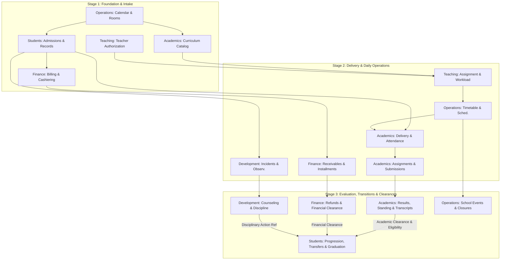

# SIS — Module Decomposition and Delivery Roadmap

## A. Executive Summary

This document establishes a pragmatic, domain-driven module decomposition and a three-stage delivery roadmap for the School Information System (SIS), derived directly from the authoritative specifications of the six business domains: **Students**, **Academics**, **Development**, **Teaching**, **Finance**, and **Operations**.

### Decomposition Strategy

The decomposition follows an **operational-first, capability-driven approach** rather than a technical, entity-based, or screen-based breakdown. Each domain is divided into cohesive business modules that reflect real-world school operational responsibilities, and further detailed into operational submodules representing concrete administrative and instructional workflows:

1. **Strict Ownership Boundaries:** Core business entities have single, unambiguous owners. Student Identity and official administrative status belong exclusively to **Students**; curriculum, learning evidence, and academic standing belong to **Academics**; non-academic growth, behavior, and wellbeing belong to **Development**; teacher credentials, availability, and staffing authorizations belong to **Teaching**; student-school monetary obligations, payments, and receivables belong to **Finance**; and shared temporal, spatial, and communication coordination belongs to **Operations**.
2. **Recommendation vs. Execution Decoupling:** Cross-domain decisions adhere strictly to the principle that upstream domains recommend or evaluate eligibility (e.g., Academics recommends promotion or evaluates graduation eligibility; Finance evaluates financial clearance; Development recommends disciplinary actions), while the downstream domain executes the authoritative administrative state transition (e.g., Students executes promotion, graduation, or withdrawal).
3. **No Artificial Shared Modules:** Cross-cutting concerns (such as approvals, audit history, and clearances) are owned in-context by the domain responsible for that business outcome, preventing bloated "common" or "shared" modules that blur architectural boundaries.
4. **Pragmatic Granularity:** The 6 domains are decomposed into **19 cohesive modules** and **62 targeted submodules**, avoiding premature micro-decomposition while maintaining operational separation of duties.

### Logic of the Three-Stage Roadmap

The implementation sequence is structured around the operational lifecycle of a school year, prioritizing capabilities that unblock downstream workflows:

- **Stage 1: Operational Foundation, Academic Structure & Student Intake**  
  Establishes the enterprise operational baseline (academic calendar, room inventory), curriculum structures, teaching resource authorizations, prospective applicant admissions, initial student enrollment/placement, and foundational fee billing and payment receipt. This stage enables a school to open its doors, onboard staff, admit students, and collect initial tuition/fees.
- **Stage 2: Learning Delivery, Timetabling & Daily School Operations**  
  Activates the daily operational rhythm: building the operational timetable, staffing learning demand with authorized teachers, assigning students to learning units, recording daily instructional attendance, issuing assignments, capturing student work, tracking overdue accounts with installment payment arrangements, recording behavior observations/incidents, and publishing school announcements.
- **Stage 3: Term-End Evaluation, Student Support, Lifecycle Transitions & Clearances**  
  Closes the academic and administrative cycle: approving and publishing final academic results, calculating academic standing, generating report cards and official transcripts, running confidential counseling/wellbeing support and formal discipline cases, managing extracurricular programs, executing purpose-specific clearances (Academic and Financial Clearances for Transfer Out and Graduation), processing student progression/retention, handling external transfers and withdrawals, and executing graduation with automated alumni transition.

---

## B. Module Decomposition

The table below defines the complete module decomposition for the six SIS domains.

| Domain | Module | Responsibility | Submodules | Dependencies |
|---|---|---|---|---|
| **Students** | **Admissions Management** | Manages prospective student intake from application registration through document verification and admission decision. | • Application Registration • Document Intake & Verification • Application Review & Decision | • **Operations / Academic Calendar & Operating Periods:** Requires active admission periods and calendar context. |
| **Students** | **Student Records & Placement** | Authoritative management of official student identity, parent/guardian relationships, student numbering, and organizational placement. | • Student Identity Management • Parent & Guardian Relationship Directory • Student Number Generation & Assignment • Administrative Placement (Campus, Level, Grade, Cohort, Homeroom Group) • Identity History & Corrections | • **Students / Admissions Management:** Consumes accepted applicants to initialize student records. • **Operations / Academic Calendar & Operating Periods:** Consumes campus and school organizational structure. |
| **Students** | **Student Lifecycle & Transitions** | Authoritative execution of official administrative status changes across the student lifecycle. | • Enrollment Execution • Administrative Placement Changes • Leave of Absence Management (Leave, Return, Expired) • Promotion & Retention Execution • Transfer Management (Internal & External Transfer Out) • Withdrawal Processing • Graduation Execution & Alumni Activation • Clearance Request Coordination | • **Students / Student Records & Placement:** Operates on active student identities and placement history. • **Academics / Academic Standing, Progress & Reporting:** Consumes promotion/retention recommendations, graduation eligibility, and Academic Clearance (Transfer Out). • **Finance / Receivables, Financial Aid & Clearance:** Consumes enrollment payment confirmation and Financial Clearance (Transfer Out, Graduation). • **Development / Behaviour & Discipline:** Consumes authorized disciplinary decision references for suspension/withdrawal. |
| **Academics** | **Curriculum & Academic Structure** | Defines learning structures, learning units, academic expectations, and individualized student learning plans. | • Learning Structure & Learning Unit Definition • Academic Requirements & Versioning • Student Learning Plans (SLP) & Academic Plan Adjustments | • **Operations / Academic Calendar & Operating Periods:** Consumes academic year and term definitions. • **Students / Student Records & Placement:** Consumes student identity for exceptional Student Learning Plans. |
| **Academics** | **Learning Delivery & Attendance** | Manages student academic participation in learning units and tracks attendance during learning activities. | • Academic Participation Registration • Learning Activity Management • Student Learning Attendance Recording & Correction | • **Academics / Curriculum & Academic Structure:** Consumes defined Learning Units. • **Students / Student Records & Placement:** References eligible active students. • **Teaching / Teaching Assignment & Staffing:** References assigned teachers for learning activities. • **Operations / Timetable & Room Allocation:** Consumes scheduled occurrence time and room context. |
| **Academics** | **Assessment & Grading** | Manages learning activity assignments, student submissions, assessment evaluations, and grade authorization. | • Activity Assignments & Submissions Management • Assessment Planning & Rubrics • Learning Evidence Evaluation & Feedback • Academic Result Approval & Publication • Assessment Record Corrections | • **Academics / Learning Delivery & Attendance:** Operates on learning activities and student participation. • **Teaching / Teaching Assignment & Staffing:** Verifies teacher authorization to evaluate work. |
| **Academics** | **Academic Standing, Progress & Reporting** | Tracks learning progress, coordinates academic interventions, determines standing, issues progression recommendations, and executes Academic Clearance. | • Learning Progress & Completion Tracking • Academic Intervention Management • Academic Standing Determination • Promotion & Graduation Eligibility Evaluation • Purpose-Specific Academic Clearance (Transfer Out) • Report Card & Official Transcript Generation | • **Academics / Assessment & Grading:** Consumes approved academic results. • **Academics / Curriculum & Academic Structure:** Evaluates progress against academic requirements. • **Students / Student Records & Placement:** Consumes student administrative placement context. |
| **Development** | **Behaviour & Discipline** | Records factual conduct observations, recognizes positive behaviour, manages incident reports, and investigates formal discipline cases. | • Behaviour Observation Recording • Positive Behaviour Recognition • Incident Reporting & Triage • Discipline Case Investigation & Determination • Disciplinary Decision Reporting to Students | • **Students / Student Records & Placement:** References authoritative student identity. • **Operations / Timetable & Room Allocation:** References location and event context for incident reports. |
| **Development** | **Student Wellbeing & Counselling** | Manages confidential student referrals, counselling sessions, social-emotional wellbeing support, and non-academic intervention plans. | • Development Referral Intake & Triage • Confidential Counselling Case & Session Tracking • Student Wellbeing Support & Safety Escalation • Non-Academic Intervention Planning & Review | • **Students / Student Records & Placement:** References student identity and parent/guardian contact context. • **Academics / Academic Standing, Progress & Reporting:** Consumes non-academic support referrals from academic staff. |
| **Development** | **Extracurricular & Achievements** | Manages non-academic development programs, student participation tracking, and non-academic achievement recognition. | • Extracurricular Program Catalog & Rules • Extracurricular Participation & Tracking • Non-Academic Achievement Recognition & Awards | • **Students / Student Records & Placement:** References active student identity. • **Operations / Events & Operational Communications:** Coordinates activity scheduling and room reservations. |
| **Teaching** | **Teaching Resources & Authorization** | Manages recognized teacher profiles, verifies qualification evidence, and governs teaching authorizations. | • Teaching Profile Management • Teaching Capability Catalog • Qualification Evidence Submission & Verification • Teaching Authorization Lifecycle (Active, Restricted, Suspended, Revoked, Under Supervision) | • **None (Foundational):** Consumes external qualification documents and school accreditation rules. |
| **Teaching** | **Teacher Availability & Workload** | Manages teacher availability declarations, tracks teaching workload, and enforces capacity limits. | • Teacher Availability & Unavailability Scheduling • Workload Calculation & Monitoring (Teaching Hours) • Capacity Limit Monitoring (Warning vs. Prohibited Thresholds) • Workload Exception Approval Workflow | • **Teaching / Teaching Resources & Authorization:** Operates on active teaching profiles. • **Operations / Academic Calendar & Operating Periods:** Consumes operating periods and school days. |
| **Teaching** | **Teaching Assignment & Staffing** | Ingests teaching demand, evaluates candidate eligibility, assigns teachers to learning/development work, and manages substitutions. | • Teaching Demand Intake & Clarification • Teacher Eligibility Evaluation • Teaching Assignment Management (Roles & Commitments) • Substitution & Reassignment Handling • Assignment Completion & Teaching History | • **Teaching / Teaching Resources & Authorization:** Verifies teacher qualifications and authorizations. • **Teaching / Teacher Availability & Workload:** Evaluates remaining teacher capacity and availability. • **Academics / Curriculum & Academic Structure:** Receives academic teaching demand. • **Operations / Timetable & Room Allocation:** Supplies assignment context to the scheduler. |
| **Finance** | **Fee Policy & Student Billing** | Governs charge rules, maintains student financial accounts, assesses charges, and generates billing statements. | • Financial Policy & Fee Rule Definition • Student Financial Account Management • Charge Assessment & Obligation Issuance • Billing & Financial Statement Generation • Policy-Driven Discounts & Waivers Administration | • **Students / Student Records & Placement:** References student identity, placement, and authorized financial contacts. • **Operations / Academic Calendar & Operating Periods:** Consumes billing windows, terms, and academic year context. |
| **Finance** | **Payment Processing & Cashiering** | Processes payment submissions, verifies and confirms receipts, allocates funds to obligations, and manages credit balances. | • Payment Receipt & Confirmation • Payment Allocation & Reallocation • Credit Balance & Overpayment Management • Refund Request, Approval & Execution | • **Finance / Fee Policy & Student Billing:** Allocates payments against valid issued obligations. • **Students / Student Records & Placement:** References student and authorized payer identities. |
| **Finance** | **Receivables, Financial Aid & Clearance** | Manages overdue receivables, payment arrangements, scholarship awards, and purpose-specific financial clearances. | • Overdue Receivable Tracking & Aging Reminders • Payment Arrangements & Installment Schedules • Scholarship Eligibility Review & Award Application • Purpose-Specific Financial Clearance (Transfer Out, Graduation) • Financial Adjustments, Reversals & Dispute Management | • **Finance / Fee Policy & Student Billing:** Evaluates outstanding mandatory obligations. • **Finance / Payment Processing & Cashiering:** Consumes payment allocations and settlement states. • **Academics / Academic Standing, Progress & Reporting:** Consumes academic achievement evidence for scholarships. • **Development / Extracurricular & Achievements:** Consumes non-academic achievement evidence for scholarships. |
| **Operations** | **Academic Calendar & Operating Periods** | Establishes shared operating timeframes, the master school calendar, instructional days, holidays, and official closures. | • Academic Year & Period Management • School Calendar Definition (Instructional Days & Holidays) • Calendar Amendments & Campus Closure Coordination | • **None (Foundational):** Authoritative root time context for the entire SIS. |
| **Operations** | **Timetable & Room Allocation** | Coordinates operational requests, evaluates feasibility, builds the operational timetable, and allocates rooms. | • Operational Activity Request Intake & Feasibility • Operational Timetable & Scheduled Occurrences • Room Operational Context & Inventory (Type, Capacity, Suitability) • Room Availability, Tentative Holds & Allocation • Operational Conflict Detection & Override Management | • **Operations / Academic Calendar & Operating Periods:** Uses operating periods and instructional days. • **Academics / Learning Delivery & Attendance:** Ingests learning activity scheduling requests. • **Teaching / Teaching Assignment & Staffing:** Consumes approved teacher assignments and availability. |
| **Operations** | **Events & Operational Communications** | Coordinates the operational logistics of school events and publishes official school-wide announcements. | • School Event Operational Lifecycle • Operational Announcement Publication & Audience Delivery • Operational Disruption & Emergency Schedule Notifications | • **Operations / Academic Calendar & Operating Periods:** Uses master calendar context. • **Operations / Timetable & Room Allocation:** Allocates event venues and detects event conflicts. • **All Domains:** Ingests announcement requests from authorized domain authorities. |

---

## C. Three-Stage Roadmap

The implementation is sequenced across three distinct operational stages. Each stage delivers an end-to-end, usable operational increment.

| Stage | Domain | Module / Submodule | Prerequisites | Operational Deliverable |
|---|---|---|---|---|
| **Stage 1** | **Operations** | **Academic Calendar & Operating Periods** • Academic Year & Operating Period Definition • School Calendar Definition (Instructional Days & Holidays) | None (Foundational enterprise configuration). | School leadership establishes the authoritative school calendar, terms, semesters, instructional days, and official holidays for the upcoming school year. |
| **Stage 1** | **Operations** | **Timetable & Room Allocation** • Room Operational Context & Inventory (Type, Capacity, Suitability) | None. | Facilities staff registers all physical campus rooms with maximum occupancy capacities, room types (classroom, lab, hall), and suitability tags (projectors, accessibility). |
| **Stage 1** | **Academics** | **Curriculum & Academic Structure** • Learning Structure & Learning Unit Definition • Academic Requirements & Versioning | Operations: Academic Calendar & Operating Periods (operating terms). | Curriculum coordinators define approved Learning Units (subjects, courses, modules), academic completion criteria, and curriculum policy versions. |
| **Stage 1** | **Teaching** | **Teaching Resources & Authorization** • Teaching Profile Management • Teaching Capability Catalog • Qualification Evidence Submission & Verification • Teaching Authorization Lifecycle | None. | School administrators onboard teachers, catalog verified credentials, and grant formal Teaching Authorizations (including supervised teaching standing). |
| **Stage 1** | **Teaching** | **Teacher Availability & Workload** • Teacher Availability & Unavailability Scheduling | Teaching: Teaching Resources & Authorization (active profiles); Operations: Academic Calendar & Operating Periods. | Teachers and teaching coordinators establish available working days, shifts, campus availability, and planned leave for the operating term. |
| **Stage 1** | **Students** | **Admissions Management** • Application Registration • Document Intake & Verification • Application Review & Decision | Operations: Academic Calendar & Operating Periods (admission window). | Admissions officers register prospective student applications, verify submitted identity documents, and record official acceptance/rejection decisions. |
| **Stage 1** | **Students** | **Student Records & Placement** • Student Identity Management • Parent & Guardian Relationship Directory • Student Number Generation & Assignment • Administrative Placement (Grade, Cohort, Campus) | Students: Admissions Management (accepted applicants); Operations: Academic Calendar & Operating Periods. | Administration officers register official student master identities, establish parent/guardian emergency and financial contacts, assign unique student numbers, and assign administrative homerooms/grades. |
| **Stage 1** | **Students** | **Student Lifecycle & Transitions** • Enrollment Execution | Students: Student Records & Placement (identity and placement); Finance: Fee Policy & Student Billing (enrollment fee/confirmation). | Administration officers execute formal enrollment, transitioning accepted applicants into Active official student status. |
| **Stage 1** | **Finance** | **Fee Policy & Student Billing** • Financial Policy & Fee Rule Definition • Student Financial Account Management • Charge Assessment & Obligation Issuance • Billing & Financial Statement Generation • Discounts & Waivers Administration | Students: Student Records & Placement (student identity and placement context); Operations: Academic Calendar & Operating Periods. | Finance officers configure fee structures (tuition, admission fees), issue financial obligations to student accounts, generate initial billing notices, and apply approved policy discounts/waivers. |
| **Stage 1** | **Finance** | **Payment Processing & Cashiering** • Payment Receipt & Confirmation • Payment Allocation & Reallocation | Finance: Fee Policy & Student Billing (issued obligations). | Cashiers receive and confirm payments across supported payment methods, issue official receipts, and allocate collected funds to enrollment and tuition obligations. |
| **Stage 2** | **Teaching** | **Teaching Assignment & Staffing** • Teaching Demand Intake & Clarification • Teacher Eligibility Evaluation • Teaching Assignment Management (Roles & Commitments) • Substitution & Reassignment Handling • Assignment Completion & Teaching History | Stage 1: Teaching Resources & Authorization; Stage 1: Teacher Availability; Stage 1: Curriculum & Academic Structure. | Teaching coordinators review academic teaching demands, evaluate teacher capability/capacity, approve official Teaching Assignments (primary, assistant, assessor), and execute teacher substitutions. |
| **Stage 2** | **Teaching** | **Teacher Availability & Workload** • Workload Calculation & Monitoring (Teaching Hours) • Capacity Limit Monitoring & Overload Exceptions | Teaching: Teaching Assignment & Staffing (approved assignments). | Academic heads track teacher workload commitments against capacity thresholds (warning vs. prohibited) and approve workload overload exceptions. |
| **Stage 2** | **Operations** | **Timetable & Room Allocation** • Operational Activity Request Intake & Feasibility • Operational Timetable & Scheduled Occurrences • Room Availability, Holds & Allocation • Conflict Detection & Override Management | Stage 1: Academic Calendar & Operating Periods; Stage 1: Room Inventory; Teaching: Teaching Assignment & Staffing; Academics: Learning Delivery & Attendance. | Timetable schedulers build the master operational timetable, allocate rooms using priority rules and tentative holds, detect room/teacher double-bookings, and publish schedules. |
| **Stage 2** | **Academics** | **Curriculum & Academic Structure** • Student Learning Plans (SLP) & Academic Plan Adjustments | Stage 1: Curriculum & Academic Structure; Stage 1: Student Records & Placement. | Academic coordinators establish individualized learning plans and plan adjustments (accommodations, substitutions, exemptions) for students with exceptional learning needs. |
| **Stage 2** | **Academics** | **Learning Delivery & Attendance** • Academic Participation Registration • Learning Activity Management • Student Learning Attendance Recording & Correction | Stage 1: Student Records & Placement; Stage 1: Curriculum & Academic Structure; Operations: Timetable & Room Allocation; Teaching: Teaching Assignment & Staffing. | Academic staff registers students into learning units; teachers conduct scheduled learning activities and record/correct daily student instructional attendance. |
| **Stage 2** | **Academics** | **Assessment & Grading** • Activity Assignments & Submissions Management • Assessment Planning & Rubrics • Learning Evidence Evaluation & Feedback | Academics: Learning Delivery & Attendance (learning activities); Teaching: Teaching Assignment & Staffing. | Teachers issue academic assignments with due dates, receive student submissions (tracking submitted, late, missing, excused), and record provisional scores and qualitative feedback. |
| **Stage 2** | **Finance** | **Payment Processing & Cashiering** • Credit Balance & Overpayment Management | Stage 1: Payment Processing & Cashiering. | Finance officers track confirmed overpayments as credit balances held on student accounts for future charge allocation. |
| **Stage 2** | **Finance** | **Receivables, Financial Aid & Clearance** • Overdue Receivable Tracking & Aging Reminders • Payment Arrangements & Installment Schedules | Stage 1: Fee Policy & Student Billing; Stage 1: Payment Processing & Cashiering. | Receivables officers monitor aging accounts, issue configured overdue reminders, and negotiate formal payment arrangements with installment schedules for delinquent accounts. |
| **Stage 2** | **Development** | **Behaviour & Discipline** • Behaviour Observation Recording • Positive Behaviour Recognition • Incident Reporting & Triage | Stage 1: Student Records & Placement; Operations: Timetable & Room Allocation. | Teachers and staff record factual positive or concerning behaviour observations, award commendations, log incident reports, and triage immediate safety/support actions. |
| **Stage 2** | **Operations** | **Events & Operational Communications** • Operational Announcement Publication & Audience Delivery • Operational Disruption & Emergency Notifications | Stage 1: Academic Calendar & Operating Periods; Stage 1: Student Records & Placement; Stage 1: Teaching Resources & Authorization. | Communications officers publish targeted announcements and schedule disruption notices to students, parents, and teachers. |
| **Stage 3** | **Academics** | **Assessment & Grading** • Academic Result Approval & Publication • Assessment Record Corrections | Stage 2: Assessment & Grading (provisional evaluations). | Academic authorities moderate and approve final assessment results, publish grades to students and guardians, and execute formal auditable record corrections. |
| **Stage 3** | **Academics** | **Academic Standing, Progress & Reporting** • Learning Progress & Completion Tracking • Academic Intervention Management • Academic Standing Determination • Promotion & Graduation Eligibility Evaluation • Purpose-Specific Academic Clearance (Transfer Out) • Report Card & Official Transcript Generation | Academics: Assessment & Grading (approved results); Stage 1: Curriculum & Academic Structure; Stage 1: Student Records & Placement. | Academic coordinators track unit completions, manage remediation plans, calculate academic standing, issue promotion/graduation eligibility recommendations, determine Academic Clearance for transfer-out, and generate official report cards/transcripts. |
| **Stage 3** | **Development** | **Behaviour & Discipline** • Discipline Case Investigation & Determination • Disciplinary Decision Reporting to Students | Stage 2: Behaviour & Discipline (incident triage). | Discipline committees conduct formal case investigations, record student responses, make authorized findings/actions, and transmit formal suspension/expulsion recommendations to Students. |
| **Stage 3** | **Development** | **Student Wellbeing & Counselling** • Development Referral Intake & Triage • Confidential Counselling Case & Session Tracking • Student Wellbeing Support & Safety Escalation • Non-Academic Intervention Planning & Review | Stage 1: Student Records & Placement; Academics: Academic Standing, Progress & Reporting (referrals). | School counselors manage highly restricted counseling session notes, coordinate student wellbeing plans, manage non-academic behavior improvement plans, and execute child protection escalations. |
| **Stage 3** | **Development** | **Extracurricular & Achievements** • Extracurricular Program Catalog & Rules • Extracurricular Participation & Tracking • Non-Academic Achievement Recognition & Awards | Stage 1: Student Records & Placement; Stage 2: Timetable & Room Allocation. | Extracurricular coordinators define club/sports programs, track student extracurricular rosters/attendance, and issue verified awards for sports, arts, and leadership. |
| **Stage 3** | **Finance** | **Payment Processing & Cashiering** • Refund Request, Approval & Execution | Stage 2: Payment Processing & Cashiering (credit balances). | Finance officers review refund requests against confirmed refundable credit, route through Finance Authority approval, and execute disbursements to original payers. |
| **Stage 3** | **Finance** | **Receivables, Financial Aid & Clearance** • Scholarship Eligibility Review & Award Application • Purpose-Specific Financial Clearance (Transfer Out, Graduation) • Financial Adjustments, Reversals & Dispute Management | Stage 2: Receivables, Financial Aid & Clearance; Academics: Academic Standing, Progress & Reporting; Development: Extracurricular & Achievements. | Scholarship committees award academic/merit scholarships; Finance officers evaluate mandatory obligations to determine Financial Clearance for Transfer Out and Graduation; billing disputes and value reversals are audited and settled. |
| **Stage 3** | **Students** | **Student Lifecycle & Transitions** • Administrative Placement Changes • Leave of Absence Management (Leave, Return, Expired) • Promotion & Retention Execution • Transfer Management (Internal & External Transfer Out) • Withdrawal Processing • Graduation Execution & Alumni Activation | Stage 1: Student Records & Placement; Academics: Academic Standing, Progress & Reporting (eligibility and Academic Clearance); Finance: Receivables, Financial Aid & Clearance (Financial Clearance); Development: Behaviour & Discipline (disciplinary determinations). | Administration officers execute mid-year placement updates, process student leaves/returns, execute bulk promotions/retentions based on academic recommendations, process external transfers (verified by dual clearances), execute withdrawals, and finalize graduations with automatic alumni activation. |
| **Stage 3** | **Operations** | **Events & Operational Communications** • School Event Operational Lifecycle • Calendar Amendments & Campus Closure Coordination | Stage 1: Academic Calendar & Operating Periods; Stage 2: Timetable & Room Allocation. | Event coordinators manage operational logistics for school assemblies, sports days, and graduation ceremonies; calendar authorities execute emergency school closures and schedule makeup days. |

---

## D. Stage Completion Criteria

For each stage, the following minimum observable conditions verify that the operational outcome has been achieved:

### Stage 1: Operational Foundation, Academic Structure & Student Intake

- [ ] **School Calendar Published:** An Academic Year and its constituent operational periods (terms/semesters) are active, defining instructional days, weekends, and holidays.
- [ ] **Room Catalog Active:** Physical campus rooms are registered with defined occupancy limits, room categories (classroom, lab, hall), and operational suitability characteristics.
- [ ] **Curriculum Catalog Ready:** Core Learning Units (subjects/courses) with versioned academic completion rules are published and available for academic planning.
- [ ] **Teacher Credentials Authorized:** Teaching resources have verified qualification records and active Teaching Authorizations (including supervised teaching standing where required).
- [ ] **Teacher Availability Committed:** Teaching staff has submitted, and coordinators have approved, availability calendars for the upcoming academic period.
- [ ] **Admissions Processed:** Prospective student applications have progressed through document verification, review, and recorded acceptance or rejection decisions.
- [ ] **Students Officially Registered:** Accepted applicants are converted into official Student Records with unique, non-reusable Student Numbers and initial homeroom/grade administrative placements.
- [ ] **Initial Enrollment Activated:** Accepted applicants are formally transitioned to `Active` student status upon meeting enrollment criteria.
- [ ] **Fee Policies & Invoices Issued:** Tuition and enrollment charge rules are assessed to student financial accounts, producing traceable billing statements with explicit due dates.
- [ ] **Payment Receipts Issued:** Cashiers confirm received payments, issue official payment receipts, and successfully allocate funds against student enrollment/tuition obligations.

### Stage 2: Learning Delivery, Timetabling & Daily School Operations

- [ ] **Teaching Demand Staffed:** Academic teaching demands are matched with eligible, authorized teachers to produce approved Teaching Assignments with defined roles (primary, assistant, assessor).
- [ ] **Workload Limits Monitored:** Teacher workload (in Teaching Hours) is computed from active assignments, enforcing warning thresholds and requiring explicit approval for overload exceptions.
- [ ] **Operational Timetable Published:** Scheduled Occurrences for all learning activities are placed into conflict-free time slots and room allocations, respecting tentative hold rules.
- [ ] **Individual Learning Plans Active:** Exceptional students have approved Student Learning Plans (at most one active SLP per period) and documented plan adjustments (accommodations, substitutions, exemptions).
- [ ] **Academic Participation Established:** Active students are enrolled in specific Learning Units, maintaining distinction from their administrative homeroom placements.
- [ ] **Instructional Attendance Captured:** Teachers successfully submit daily session attendance (present, absent, late, excused), with audit trails for corrections.
- [ ] **Assignments & Submissions Processed:** Teachers issue assignments linked to learning activities; student submissions are tracked with explicit statuses (`Submitted`, `Late`, `Missing`, `Excused`, `Exempted`) and provisional scores.
- [ ] **Overdue Receivables Tracked:** Overdue student accounts are classified into aging tiers; automated or operational reminders are delivered per policy.
- [ ] **Installment Plans Active:** Delinquent accounts have negotiated Payment Arrangements with active installment schedules approved by Finance Authorities.
- [ ] **Credit Balances Managed:** Confirmed overpayments are maintained as credit balances on student accounts, ready for future obligation settlement.
- [ ] **Behavior Observations & Incidents Logged:** Staff records positive commendations and incident reports, with immediate triage actions recorded.
- [ ] **Operational Announcements Delivered:** Operational notifications and timetable adjustments are published to targeted student, guardian, and teacher audiences.

### Stage 3: Term-End Evaluation, Student Support, Lifecycle Transitions & Clearances

- [ ] **Academic Results Finalized:** Provisional scores are moderated, approved by Academic Authorities, published to students/guardians, and corrected only through auditable correction workflows.
- [ ] **Academic Standing & Eligibility Computed:** Student progress is evaluated to record Academic Standing (`Good Standing`, `Conditional Standing`, `Not In Good Standing`), Promotion Recommendations (`Promotion Eligible`, `Retention Recommended`, `Conditional Promotion`), and Graduation Eligibility.
- [ ] **Report Cards & Transcripts Generated:** Official periodic report cards and cumulative academic transcripts are compiled directly from approved historical results.
- [ ] **Discipline Cases Resolved:** Formal discipline cases progress through evidence gathering, student response, authorized determination, and communication of findings.
- [ ] **Confidential Counseling Managed:** Counselors maintain restricted session notes and manage student wellbeing support plans with proper safety escalation controls.
- [ ] **Extracurricular Participation Completed:** Student participation in clubs and sports is verified, and non-academic achievement awards are officially recognized.
- [ ] **Refunds Executed:** Valid refund requests are verified against refundable credit, approved by Finance Authority, and disbursed to the original payer.
- [ ] **Dual Clearances Determined:** Purpose-specific Academic Clearance and Financial Clearance for `Transfer Out` and `Graduation` are evaluated and recorded with explicit blocker reporting.
- [ ] **External Transfers Completed:** Students requesting transfer-out are transitioned to `Transferred` status strictly upon confirmation of `Granted` Academic Clearance and `Granted` Financial Clearance.
- [ ] **Progressions & Retentions Executed:** End-of-year administrative progression is executed, updating administrative grade placements while preserving individual transition records.
- [ ] **Graduations & Alumni Converted:** Eligible students with `Granted` Financial Clearance are graduated, ending active enrollment and automatically establishing `Alumni` status.
- [ ] **School Events & Closures Closed:** Major school events (e.g., graduation ceremonies) complete their operational lifecycle, and calendar closures are formally archived.

---

## E. Dependencies and Risks

### 1. Material Cross-Domain Dependencies

### 2. Domain Boundary Issues & Structural Governance

- **Administrative Placement vs. Academic Participation:**  
  *Rule:* Administrative enrollment in Students does not create Academic Participation. Students administratively placed in Grade 6 may participate in Grade 5 or Grade 7 Learning Units. Academics must never alter administrative placement; Students must never dictate individual course enrollment.
- **Recommendation vs. Administrative Status Execution:**  
  *Rule:* Academics determines promotion eligibility, retention recommendations, and graduation eligibility. Development determines disciplinary findings and recommends suspension/exclusion. Finance determines financial clearance. Only Students may execute administrative status changes (`Active`, `On Leave`, `Transferred`, `Withdrawn`, `Graduated`, `Alumni`).
- **Clearance Autonomy:**  
  *Rule:* Clearances are dedicated, purpose-specific evaluations. Academic Clearance evaluates only required academic prerequisites for the stated purpose; Financial Clearance evaluates only mandatory, unbilled/unsettled obligations for the stated purpose. Neither standing, grade averages, nor discretionary fees may be used to arbitrarily block clearance.
- **Confidentiality vs. Operational Coordination:**  
  *Rule:* Counseling session notes, sensitive medical disclosures, and detailed disciplinary testimony must remain sealed within Development. Only actionable operational summaries (e.g., student support accommodations or safety restrictions) may be shared with Teachers or Schedulers under minimum necessary disclosure.

### 3. Unresolved Decisions & Impact Analysis

| Unresolved Decision | Document Source | Operational & Structural Impact | Resolution Requirement |
|---|---|---|---|
| **Homeroom Ownership Boundary** | `student-domain.md` L1657 `teaching-domain.md` L1562 `operational-domain.md` L1336 | If homeroom is conflated into a single concept, changes in teacher assignment or room allocation could inadvertently alter student administrative cohort registration. | **Must be resolved before Stage 2.** *Provisional Architecture:* Homeroom administrative placement belongs to **Students**; homeroom teacher advisory responsibility is a Teaching Assignment owned by **Teaching**; physical homeroom venue allocation belongs to **Operations**. |
| **Annual Re-enrollment Ownership** | `student-domain.md` L1644 `academic-domain.md` L1627 | Ambiguity over whether returning students undergo an administrative re-enrollment in Students or a simple academic course registration in Academics. | **Must be resolved before multi-year roll-forward in Stage 3.** *Provisional Architecture:* Administrative continuing student confirmation is handled in **Students**; term-by-term subject selection/registration is handled in **Academics**. |
| **Student Number & Identity Scope across Campuses** | `student-domain.md` L1688–1693 | Multi-campus schools risk creating duplicate student records or conflicting student number sequences if student numbering is decentralized. | **Must be resolved before Stage 1 implementation.** *Provisional Architecture:* A person has exactly one authoritative master identity across the organization; Student Number format and uniqueness scope are defined centrally by school policy. |
| **Safeguarding & Health/Clinic Boundary** | `development-domain.md` L176, L1346–1352 | Unclear boundary on whether student medical records, nurse visits, and legal child protection escalations belong in Development or an external healthcare system. | **Can be deferred to Stage 3.** *Provisional Architecture:* Clinical medical treatment is explicitly out of core scope. Development manages school-based wellbeing support, factual incident logs, and restricted counseling notes only. |
| **Tuition & Benefit Stacking Policy** | `finance-domain.md` L245, L1679 | If stacking rules (combining discounts, waivers, and scholarships) are undefined, billing calculations can produce unauthorized negative balances or unexpected liabilities. | **Must be resolved before Stage 2 billing.** *Provisional Architecture:* Domain policy dictates `Allow Stacking = Yes / No` per benefit type; priority order of application must be configured explicitly by school finance authorities prior to billing execution. |
| **Mandatory vs. Optional Obligations for Clearance** | `finance-domain.md` L436, L1723 | Unclear policy on whether pending library fines, unbilled future installments, or optional activity fees block graduation and transfer. | **Must be resolved before Stage 3 clearance deployment.** *Provisional Architecture:* Adhere strictly to the domain rule: only outstanding mandatory obligations for that specific purpose block clearance. Non-mandatory charges and future installments are non-blocking. |

---

## F. Final Recommendation

The recommended three-stage implementation sequence represents the most pragmatic, low-risk path to digitizing school operations:

1. **Stage 1 delivers immediate operational value** by solving the critical school intake problem: onboarding faculty, structuring curriculum, registering applicants, admitting students, assigning homerooms, and billing tuition. A school can successfully open an academic year using Stage 1 alone.
2. **Stage 2 digitizes the daily operating heartbeat** without requiring complex end-of-term certification algorithms. Teachers receive approved teaching assignments, timetables are resolved, classrooms are allocated, daily instructional attendance is tracked, and everyday behaviour incidents and overdue tuition reminders are operationalized.
3. **Stage 3 closes the educational and administrative lifecycle** once sufficient historical academic evidence and financial records have accumulated during Stage 2. It activates grade moderation, standing evaluation, report cards, official transcripts, confidential student counseling, dual-clearance gates, promotions, external transfers, and graduations.

By decoupling recommendations from executions, keeping business capabilities strictly within their authoritative domain boundaries, and avoiding monolithic shared abstractions, this roadmap ensures that every implementation stage delivers tangible, verified business capabilities to school staff, educators, and leadership.
